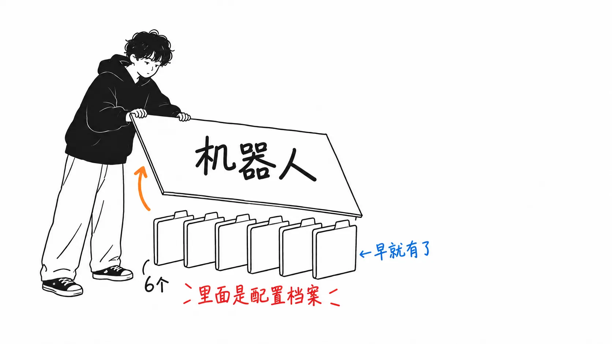
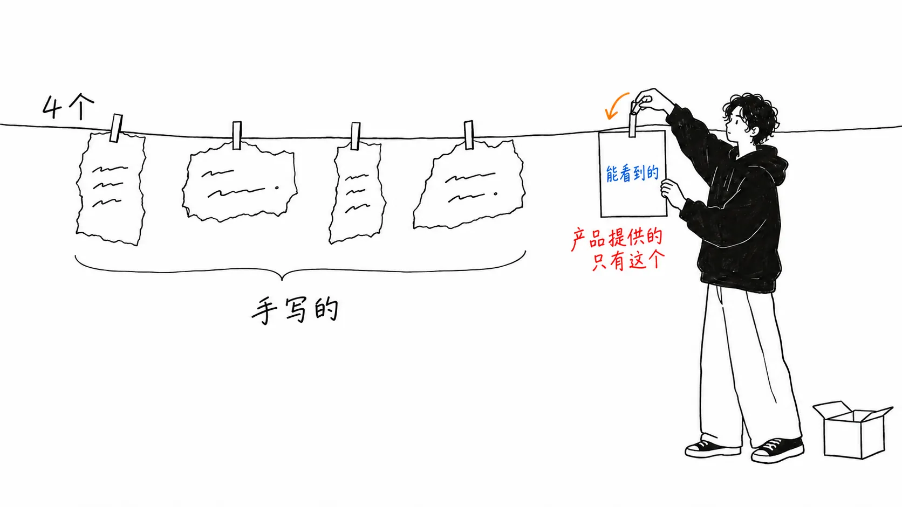
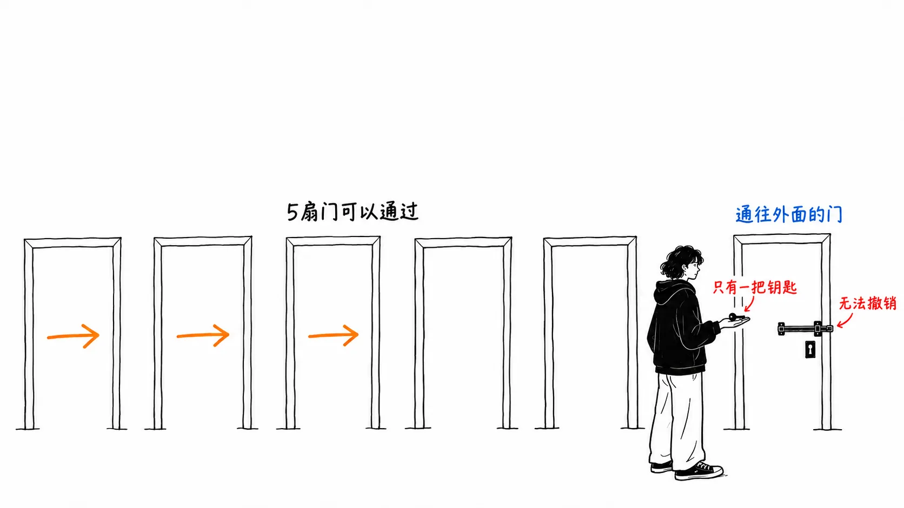

先把结论写在前面。

> 产品是真实存在的。Bot Mode 也确实如文章所说，在 8 月 16 日发布。不过官方文档自己就写着：“**没有需要学习的新原语。Bot 就是 Hermes 的 profile。**” 文章当作价值来写的六份角色契约和交接记录，是**即使没有 Bot Mode 也成立**的设计。能移植的是这一部分。

## 关于这篇文章

原文是 [@VibeMarketer_ 的 X Article](https://x.com/vibemarketer_/status/2093330541177352217)《How to Build a One-Person Media Company With Hermes Bots》（2026 年 8 月 28 日）。讲的是用六个 Bot 搭建一人媒体公司的架构。

先确认产品。与文章的描述一致。

| 文章的描述 | 实际 |
| --- | --- |
| hermes agent 的 8 月 16 日发布 | `NousResearch/hermes-agent` **v0.20.3（v2026.8.16.2），2026 年 8 月 16 日**。MIT |
| bot mode | 同一版本中随桌面端捆绑并默认开启 |
| profiles（独立的记忆、会话、技能） | 隔离在 `~/.hermes/profiles/<name>/` 下 |
| kanban（依赖、评论、评审、重试） | 基于 sqlite。插件 SDK 上的第一个插件 |

**坦白交代。** 我没有安装 Hermes。以下只是读了原文、Hermes 的官方文档、发布说明、GitHub 的差异，以及 MarkTechPost 的报道之后得出的结果。我没有真正跑过这六个 Bot。

## 官方文档比文章还要克制

Bot Mode 的文档里是这么写的。

> **There is no new primitive to learn: a Bot is a Hermes profile** — isolated config, memory, skills, credentials, and chat history under `~/.hermes/profiles/<name>/`. **Bot Mode is a UI over that primitive**, so everything you do in it is visible from the CLI too.

没有需要学习的新原语。Bot 就是 Hermes 的 profile。Bot Mode 只不过是架在这个原语之上的 UI。

不仅如此，文档里连对照表都给了。

| Bot Mode 里的操作 | Shell 中的等价物 |
| --- | --- |
| 与 Bot 对话 | `hermes -p <name> chat` |
| Bot 的文件、技能、记忆 | `~/.hermes/profiles/<name>/` |
| 例程（定期执行） | `hermes cron list`（以 `[bot:<name>]` 这样的名字列出） |
| 创建、查看 profile | `hermes profile create`, `hermes profile list` |

Bot 之间的消息，据 MarkTechPost 报道，实质上也是 CLI 的交接。飞出去的是 `hermes -p <name> chat -c "Agent Inbox" -q "..."`。

也就是说，“六个 Bot 的团队”是**六个 profile 目录，加一个 sqlite 看板，再加架在上面的有脸面的 UI。** 文章说“bot mode / profiles / kanban 这三层把需要的部件凑齐了”，但 profiles 以前就有。8 月 16 日多出来的，是**变得看得见了。**

## 文章列了四样需要的东西，产品只发放了其中一样

这里引用文章本身最好的一句。

> this is why six independent chatbots are not a media company. they need **clear ownership, shared context, structured handoffs, and one feedback loop**.

六个独立的聊天机器人不是媒体公司。需要的是明确的所有权、共享的上下文、结构化的交接，以及一个反馈闭环。

我认为这是对的。而且摆在一起看，**Bot Mode 发放的，这四样一样都不是。**

| 需要的东西 | 来自哪里 |
| --- | --- |
| 明确的所有权 | 作者写的角色契约（owns / reads / returns / must not / done when） |
| 共享的上下文 | 作者设计的 obsidian vault 的结构 |
| 结构化的交接 | 作者定的 campaign 记录字段 |
| 一个反馈闭环 | 作者画的 performance → playbook 那条线 |
| （看得见） | **Bot Mode** |

四样都是作者的设计。Bot Mode 添上的只有第五行，可见性。kanban 是**搬运**交接的容器，但搬运什么，是由作者的字段定义决定的。

所以是可以移植的。只要能分开 profile 的机制，什么都行。Claude Code 的配置目录、分开的仓库、六个文件夹都可以。**角色契约的格式才是本体。**

- **owns**：这个 Bot 负责的决定
- **reads**：可以使用的文件和交接字段
- **returns**：下一个 Bot 接收的成果物的形态
- **must not**：属于其他 Bot 或人类的决定
- **done when**：可以说交接已经完成的可观测条件

最后两条最关键。没有 `must not` 和 `done when`，每个 Bot 拿到的都会是“做出好内容”这同一条宽泛的指令。按文章的说法，那是破坏 multi-agent workflow 的最短路径。

## 文章没有提到的一个上限

这是我读发布说明和文档时发现的。群聊有限制。

> Group chats open a shared room for **two to six bots**. Your message triggers up to **three serial rounds** of member turns.

2 到 6 个 Bot，最多 3 轮。文章的架构恰好是六个 Bot，所以**所有人都进去的房间，正好是人数上限。** 而且到 3 轮就会被截断。

文章的设计不会碰到这个。因为它是 signal scout → researcher → strategist → writer → distribution → editor 这样的串行流程，形式上由 kanban 来搬运。文章明确写了：**不要靠对话来协调，状态放在文件和 kanban 里。**

> use conversation for coordination. use files and kanban for state.

这一行，结果上形成了一个不会踩到 3 轮上限的设计。作者是知道上限才这样写的，还是碰巧，从文章里看不出来。不过我认为，**“不把状态放在对话里”这个判断，不管有没有上限都是对的。** 因为对话会消失，顺序也得不到保证。

## 别人的数字有一个，而且无法核实

文章里是这样写的。

> this is the exaxt system that has helped me generate over **5.8 million impressions** on X account in just the past 4 weeks.

4 周 580 万次曝光。是自己报的，没有办法核实。作为参考，这篇文章本身按 fxtwitter 的数值是 **750,902 次浏览**、9,568 个书签。一篇就有这个量，那么 4 周 580 万是够得着的。但“多亏了这套架构”这一部分，无论如何都无法核实。

这不是在责怪谁，而是说**这类指南里的数字全都是这种形式。** 我之前写的另一篇文章里，顺着“生产环境中的工具调用有 3 到 15% 会失败”这个数字去查，最终落到了一个个人博客（[我的文章](https://meikocho1.github.io/blog/three-to-fifteen-came-from-one-blog)）。那个是借来的，这个是自己的。两者都不构成测量。

## 我的看法

这篇文章里我觉得最有意思的，不是六个 Bot 的分工，也不是 obsidian，而是 **editor 的权限。**

> editor can approve, request a revision, or reject an asset. **it cannot publish.**

批准、打回、驳回都可以。**唯独不能发布。** 最后那个不可逆的操作，六个里谁也没有交给。

我同一周读的另一份指南（用 OpenAI Agents SDK 搭后台办公的那篇）里，出现了一模一样的规则。八个席位里七个负责产出候选，只有一个负责提交。生态不同、语言不同的写作者，各自独立地在同一个地方划了线。

**可以撤销的工作，想并行多少都行，无法撤销的工作，则集中到一处。** 这既不新鲜，也不是智能体特有的。和把部署权限收窄到一个人是一回事。只是一旦写在智能体的语境里，就突然被忘掉了。因为有六个 Bot，就会想让六个都干活。

还有一点。这篇文章指示要把角色契约写在 Hermes 的 `SOUL.md` 里。关于 SOUL 文件，我之前写过另一篇论文的事。那是一项测量，结论是**空的 SOUL 文件最容易受影响。** 写六个 Bot 的 SOUL 时，必然会混有写满的文件和空的文件，我认为这是文章没有触及的漏洞。写了角色契约的四个 Bot，和先随手建出来的两个 Bot，对同一条指令的反应有可能不同。

## 只带走一件事的话

**在拆分角色之前，先把 `must not` 和 `done when` 写出来。** 拆分本身没有效果。拆出来的对象如果没有“不许做什么”和“什么时候算完”，六个 Bot 就会在同一条宽泛的指令下做同样的事。这两行不挑产品，今天就能写。

## 出处

- [@VibeMarketer_, "How to Build a One-Person Media Company With Hermes Bots"](https://x.com/vibemarketer_/status/2093330541177352217)，X Article，2026 年 8 月 28 日
- [Bot Mode — Hermes Agent 官方文档](https://hermes-agent.nousresearch.com/docs/user-guide/bot-mode)
- [NousResearch/hermes-agent 发布 v0.20.3（v2026.8.16.2）](https://github.com/NousResearch/hermes-agent/releases/tag/v2026.8.16.2)（2026 年 8 月 16 日）
- Michal Sutter, ["Nous Research Ships Bot Mode for Hermes Agent"](https://www.marktechpost.com/2026/08/17/nous-research-hermes-bot-mode/)，MarkTechPost，2026 年 8 月 18 日

我没有安装 Hermes，也没有运行六 Bot 架构。CLI 的等价命令、群聊的 2 到 6 个 Bot 与 3 轮上限、profile 的路径，都是官方文档和发布说明里的记述，并非我自己确认过的。580 万次曝光这个数字是作者自己报的，没有验证手段。
