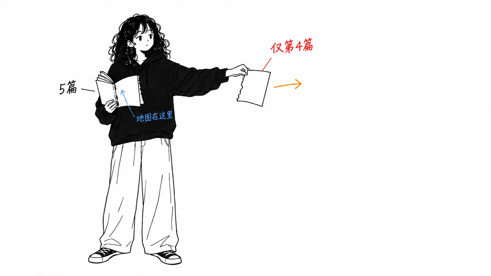
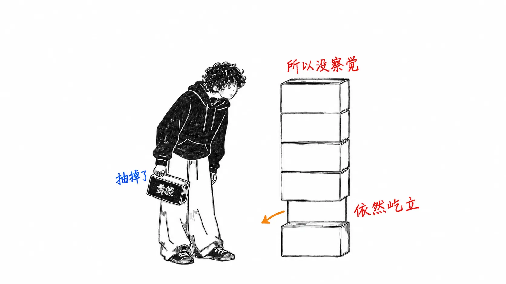
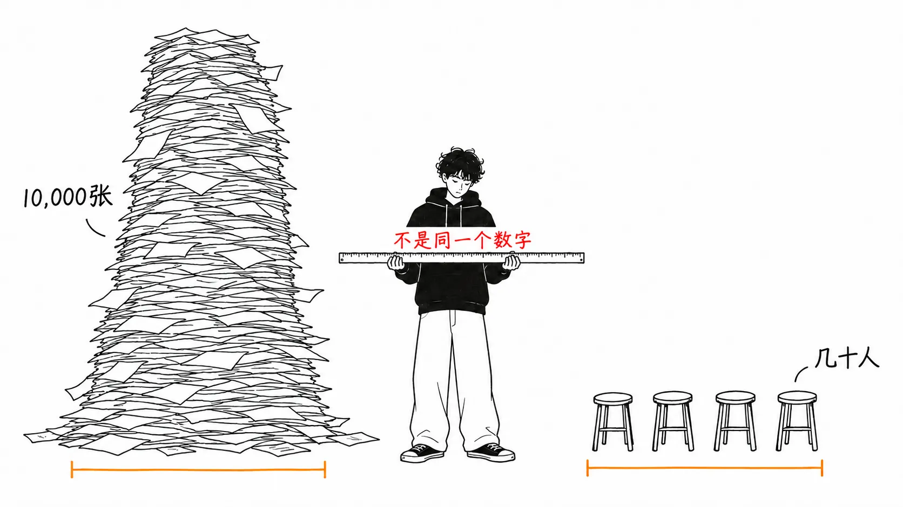
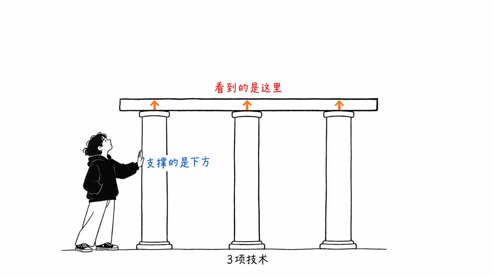

先说结论。

> 在 X 上流传的，是**一个五篇系列的最后一篇**，而且只展开了四项技能中的一项。更关键的是，让这项技能成为必要的**那句前提，X 版里没有**。“智能体有了 spec 就能把东西做出来。所以工作要转向决定 spec 里写什么”，这才是原本的论证，而 X 版是从“角色的边界变得模糊了”开始的。结论一样，依据却被调换了。

## 关于这篇文章

我读的是 [@AndrewYNg 的 X Article](https://x.com/AndrewYNg/status/2098459474608672916)“AI Engineering Skills Map: Shaping the build”（2026 年 9 月 11 日）。848,829 次浏览，7,402 次收藏。

刚读就觉得不对劲。标题里写着 Map，却没有出现地图。一查，DeepLearning.AI 的 `The Batch` 上有一个**五篇的连载**。

| 期号 | 日期 | 内容 |
| --- | --- | --- |
| issue-366 | 8 月 14 日 | **地图本身**。四项技能，以及它是怎么做出来的 |
| issue-367 | 8 月 21 日 | (i) Building and deploying AI applications |
| issue-368 | 8 月 28 日 | (ii) Software engineering fundamentals |
| issue-369 | 9 月 4 日 | (iii) Using coding agents |
| issue-370 | 9 月 11 日 | **(iv) Shaping the build** ← 在 X 上流传的就是这篇 |

**坦白说一下。** 五篇的正文我都读过了。两张图（地图全貌，以及 Shaping the build 的展开图）我取回来目测过。不过 survey 的原始数据和 job posting 的清单都没有公开，所以方法论的内部细节我没有确认。

## X 上出现的，是第四条分支

地图的全貌在 issue-366 里。共四项。

1. Building and deploying AI applications
2. Software engineering fundamentals
3. Using coding agents
4. **Shaping the build**

**前三项是技术。** 在 X 上流传的是第四项，也是唯一的非技术分支。

单独读它，会觉得这是在说“AI 工程，就是产品感觉、主动性、沟通和当事人意识”。实际上，四项子技能是这样的。

- Driving the build loop
- Making product decisions
- Communicating and leading
- High-agency ownership

没有一项是技术性的。而 issue-367 展开的 (i) 的子技能有六项：LLM foundations、Grounding models with data、Building agentic systems、Evaluation-driven development、Operating in production、Machine learning foundations。全是技术。

**在地图上，技术是 3:1 的多数；但只看 X 上出现的那一张，却像是 0:4 的非技术。**

## 消失的是前提

这是正题。在地图（issue-366）里，Ng 引入 (iv) 时是这样写的。

> **Given a clear spec, coding agents are rapidly improving at delivering to it.** Thus, our work as engineers is shifting toward deciding what should be in the spec.

只要有明确的 spec，编程智能体已经越来越能把它实现出来。**所以**工程师的工作，正转向决定 spec 里该写什么。

从技术性的前提，推出了非技术性的结论。先有“智能体的实现能力提高了”这一观察，然后才引出“那么人要做什么”。

X 版（issue-370）的开头是这样的。

> Before modern AI tools accelerated and expanded what a single developer could do, tech companies established the practice of having product managers (PMs) and designers specify what should be built and then developers build it. However, these roles are blurring.

角色的边界变得模糊了。

**我搜索了 issue-370 的正文，`clear spec` 和 `deciding what should be in the spec` 都没有出现。** 前提没了，只剩下结论。

差别看似很小，却很要紧。“角色变模糊了”是对社会的观察，谁都能说，也谁都能反对。“智能体已经能实现 spec 了，所以人要转到决定 spec 的一侧”是技术上的话，**如果智能体的实现能力不再提高，它就不成立**。一个是对潮流的描述，一个是带条件的主张。

## 方法论是有的。但容易读错

这一点 X 版里也没有。只在 issue-366 里。

> Based on an analysis of over **10,000 job postings**; carrying out **dozens of structured interviews** with AI experts, hiring managers, and recruiters; gathering data through **surveys**; and synthesizing other online data

在我最近读的几篇 AI 工程指南里，**这是第一次有人写明了方法。** 我之前写的文章里，顺着“生产环境里工具调用有 3 到 15% 会失败”这个数字追下去，最后找到的是一篇个人博客（[我的文章](https://meikocho1.github.io/blog/three-to-fifteen-came-from-one-blog)）。比起来，差距很大。

即便如此，我觉得有三点需要留意。

**10,000 是 job posting 的数量，不是人数。** 实际问过的人是 “dozens”，几十次。如果脑子里只留下 10,000 这个数字，样本量会被搞错一个甚至两个数量级。

**作者自己写的是“informal”。** “You can informally think of our process as akin to clustering on a massive dataset”。说的是“可以类比为聚类”，并没有写做了聚类。

**还在收集之中。** issue-366 的附言是请读者协助填写问卷，并写着“每当 AI 发生变化，就会更新地图”。也就是说，这不是“测量完毕的结果”，而是“测量途中的中期报告”。

## 图只在博客里有

地图的图有两张。第一张是四条分支并排的树。第二张只有 Shaping the build 用不同颜色高亮，下面挂着四项子技能。

第二张做得很好。**被高亮的分支旁边，一定映出了没被高亮的另外三条。** 看图就能一眼明白“这说的是四分之一的事”。

而 X Article 里没有这张图。正文 18 个区块，全是文字。**唯一能把比例还原回来的装置，没有放在 848,829 次浏览的那个版本里。**

## 我的看法

这不是一篇责怪 Ng 的文章。既然拆成五篇连载，每一篇被单独阅读就在所难免，而且 issue-370 本身是好文章。

我想写的是**截取的不对称性**。

五篇里，只有最后一篇传播得格外突出。我觉得能理解原因。三篇技术的是“学好 LLM 的基础”“理解取舍”“驾驭智能体”，这些是听过的话。只有第四篇说的是“你的工作范围要变了”，涉及的当事人数量要高出一个数量级。**系列里最触动职业焦虑的那一篇，飞得最远。**

而飞出去的时候，技术性的前提会掉。因为掉了，文章作为文字依然成立。“角色变模糊了，所以要有产品感”，不需要前提也能读通。读得通，所以删掉了也没人发现。

我从中得出的读法只有一个。**读到写着“应当……”的文字时，请去找让这个主张不再成立的条件。** 找不到的话，你读到的可能是前提被丢掉的版本。Ng 的原文是有条件的。如果“有 spec 智能体就能实现”这一点垮了，(iv) 的重要性也会下降。带条件的主张看起来弱，但**有条件的反而是更强的主张。** 因为定义了它会在什么情况下出错。

还有一点。issue-369 里有这样一句。

> The rapid pace of evolution for coding agents means this skill, too, is evolving rapidly — **faster than other top-level AI engineering skills**.

四项技能里，只有 (iii) 比其他的过时得更快，这是地图的作者自己写的。作为一张地图，我觉得这是难得诚实的注记。地图上写着“这一部分会比其他部分更早变旧”。

## 如果只带走一件事

**当系列文章里的一篇流到你面前时，请去找第一篇。** 连载的第一篇里，通常放着全貌和方法论。而传播开的，不是第一篇。这次五篇里有一篇被看了 84 万次，而包含地图和方法论的第一篇，并没有被链接到那里。

## 出处

- [@AndrewYNg, "AI Engineering Skills Map: Shaping the build"](https://x.com/AndrewYNg/status/2098459474608672916), X Article，2026 年 9 月 11 日（848,829 次浏览 / 4,622 个赞 / 7,402 次收藏 / 270 条回复）
- [The Batch issue-366](https://www.deeplearning.ai/the-batch/issue-366/)（2026 年 8 月 14 日）：地图全貌与方法论
- [issue-367](https://www.deeplearning.ai/the-batch/issue-367/)（8 月 21 日）/ [issue-368](https://www.deeplearning.ai/the-batch/issue-368/)（8 月 28 日）/ [issue-369](https://www.deeplearning.ai/the-batch/issue-369/)（9 月 4 日）/ [issue-370](https://www.deeplearning.ai/the-batch/issue-370/)（9 月 11 日）

X Article 的正文与 issue-370 几乎相同。“`clear spec` 这句话 X 版里没有”，意思是我搜索了 issue-370 的正文，没有找到对应内容。X Article 与 The Batch 版并非完全相同的可能性，我没有排除。

两张图是从 The Batch 的图片 URL 取回后目测的。survey 的回答、10,000 份 job posting、structured interview 的记录都没有公开，所以方法论本身我没有验证。“写明了方法”和“方法可以验证”是两回事，这一点对本文自己的主张同样适用。
