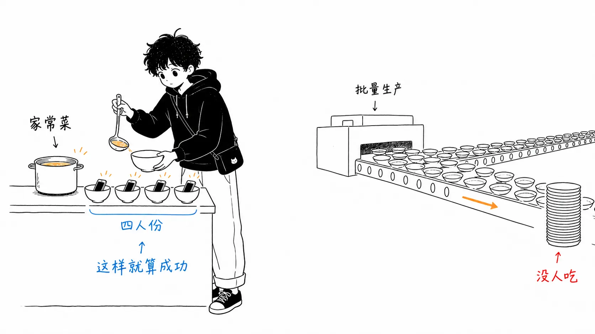
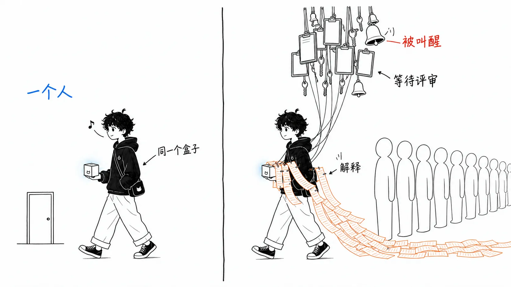
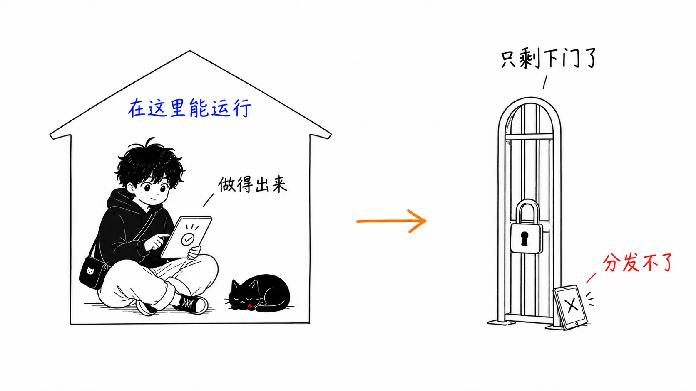

## 关于这篇文章

本文讨论的是 Adam Waxman（[@ajwaxman](https://www.ajwaxman.com/)）于 2026 年 7 月 29 日发布的文章 **"Software for One"**。这篇文章在 Hacker News 上拿到了 266 分、279 条评论。

本文分两部分。

- **第 1 部分**：Waxman 做了什么，花了多少钱（原文里的事实）
- **第 2 部分**：**我对这一现象的看法**。原文和 HN 的讨论里都没有的读法

后半部分更长。事实部分读原文就够了。

先声明一下：我没用过 Waxman 的应用，也没资格谈在他那套技术栈上做个人应用的亲身经验。我读的是原文、HN 的帖子，以及 Robin Sloan 2020 年那篇文章的原文。第 2 部分是把这三者对照着读之后得出的解读，不是实测。

---

## 第 1 部分：发生了什么

### 先说结论

> 个人应用的成本崩塌，是因为 AI 会写代码了，但**这些成本的大头从一开始就不是代码**。消失的是"对他人负有的义务"，而 AI 第一次让消除它的条件（只有一个用户）成为现实可行的选择。

### 2020 年：给四个人做的应用

出发点是 Robin Sloan 在 2020 年 2 月写的《An app can be a home-cooked meal》。他给家人做了一个消息应用 **BoopSnoop**。下载量是 4。分散在三个时区的四个人，之后好几年一直是它的日活用户。他称之为巨大的成功。

应用可以是家常菜。不需要规模，也不需要用户数。为你爱的人做就行。

不过，当时的成本他写得很坦率。做了一个星期，**其中一半耗在了代码签名的泥潭里**。

> 在一个更好的世界里，我本可以一天就做完。用某种现代的、灵活的 iOS 版 HyperCard。
>
> （Sloan，2020 年 2 月。以下引文的翻译均为笔者自译）

这篇文章后来还有一系列续篇，里面有个贯穿始终的梗。每年的更新里都写着"应我母亲的要求，我加了一个（一个）功能"。放在 2020 年的世界里，这正是合适的频率。因为每改一次，就意味着要和 Xcode 搏斗一场。

### 2026 年：知道你跑了多远的冰沙

六年后，Waxman 在半年里做出了他自己都说"做多了"的个人软件。

- 把睡眠顾问的方案原样跑起来的**睡眠应用**
- 根据当天早上的跑量**决定冰沙分量的健身应用**
- 不按年龄、而是按自己的比赛成绩制定的**马拉松计划**
- 出题考他钢琴课上学到的和弦配置的**"爵士版 Duolingo"**
- 在看专科医生之前找出记录缺漏的**病历工具**

睡眠应用的动机最具体。顾问的方案是以一份满是条件分支的 PDF 送来的：清醒时间的上限、午睡的上限、午睡失败时怎么办。他用一个星期的晚上时间把它做成了应用。结果，他妻子、保姆和他本人共用**一份午睡提前结束时会自动重排的日程表**。

健身应用则是把分散在四个应用里的数据（Strava、Oura、Withings、FatSecret）汇集到一处，根据跑的距离和强度调整当天的卡路里目标。

### 技术栈和价格

原文列出了技术栈。这里作为事实记下来。

- **框架**：Next.js on Vercel
- **前端**：Tailwind + shadcn/ui
- **认证**：Better Auth
- **数据库**：Neon 的 Postgres + Drizzle ORM
- **任务**：GitHub Actions
- **AI**：Claude Code、Vercel AI SDK、自己写的 skills

每月约 **160 美元**。明细是 Claude Code Max 100 美元，Anthropic API 10 美元，Vercel 20 美元，Neon 30 美元。不过正如他自己注明的，Neon 和 API 的大部分花在别的项目（nycjazz.guide 和 Claude Code Daily）上，而不是个人应用。从 Claude Pro 升到 Max 之前，不到 100 美元。他写道，如果只做一两个应用，每月 20 美元的编程订阅加上 5 到 10 美元的 API 用量应该就够了。

### 制作时间

这是和 2020 年差距最明显的地方。

- 睡眠应用：一周的夜间时间
- 健身应用：一个周末
- 爵士测验：哄孩子睡着之后的一个晚上

> 一两年前，这些我一个都不会想去做。做起来太慢，维护更麻烦。**如今的限制是想象力。**

关于维护，他写的东西也和 Sloan 的"一年一个功能"形成对照。修 bug、加功能、更新依赖，都比以往任何时候都容易。十次里有九次，把截图发给 Claude 就解决了。

---

## 第 2 部分：我的看法

从这里开始，是原文和 HN 里都没有的读法。

### 最激进的一句是"用完就扔也没关系"

原文总结了六条心得，让我读到一半停下来的是第四条。

> **用完就扔也没关系。** 睡眠应用我用了大约四个月。儿子能一觉睡到天亮了，我就让它退役了。如果这个应用花了几个月，那也许会有点心疼。只花了一个星期，我只会觉得，在需要它的时候它派上了用场，真好。

这看上去是在讲成本，实际上打破了软件的一个前提。

我们一直把"能运行的软件就得维护"当作物理定律，而不是一种选择。所以选库的时候要看维护频率，做内部工具的时候会被问"做的人辞职了怎么办"。这种担心是对的。**只要假定软件的寿命是无限的。**

Waxman 的睡眠应用，寿命是四个月。而且这不是失败，而是**设计的一部分**。"儿子能睡整觉"这个结束条件，从一开始就存在。

已知寿命有限的软件，用不着我们习惯性支付的那些成本中的一半。为将来扩展预留的抽象、写给别人读的文档、对五年后框架迁移的担忧。这不是偷工减料，而是**需求不同**。

我觉得有意思的是，这个想法可以带出个人应用之外。有多少组织能在内部工具的提案书里写上"预计运行期：6 个月，之后废弃"？我想几乎没有。但现实里，为只会用 6 个月的工具按永久运行的前提去做，别人都不用了还派一个维护人员守着，这样的情况多得很。

### 同样是 2026 年，专业团队却变慢了

这里把看似矛盾的东西摆出来。

Waxman 写道，维护"出乎意料地简单"。而在我另一篇文章（《AI 编程之争，争的并不是事实》）里讨论过的 AI 编程争论的数据中，专业团队的数字却朝着相反方向。在 METR 的对照实验里，经验丰富的开发者使用 AI 时反而**慢了 19%**，本人却认为自己变快了。在 DORA / Faros AI 的数据里，合并的 PR 增加了 98%，而评审时间膨胀了 91%。

同样的工具，同一年，截然相反的结果。是其中一方在撒谎吗？

我不这么认为。我觉得**只是测量的成本不同**。

把专业团队里让代码变贵的因素拆开来，就是这样：

写代码的时间。别人阅读并批准的时间。保持在除作者以外的人也能理解的状态所花的时间。确认需求出自谁之口的时间。决定出了问题半夜叫醒谁的时间。通知使用者有变更的时间。

其中 AI 直接削减的，**只有第一项**。其余的全都源于"有别人存在"。所以只有生成变快的话，其余部分相对膨胀，瓶颈就转移到了评审上。DORA 的数字恰好说明了这一点。

在 Waxman 的环境里，其余这些全是零。没有评审人。需求的来源是自己。坏了自己修。使用者是自己、妻子和保姆三个人，全都住在同一个家里。

也就是说：**不是 AI 让软件变便宜了。是把用户变成一个人让它变便宜了，而 AI 让这样的设定下也能做出实用的东西。** 我觉得这是个很容易被说反顺序的点。

### 所以正确的问题变成了"能把用户缩到几个人"

如果这种读法是对的，那么用 AI 做内部工具时要问的问题就变了。

常见的问题："这个能用 AI 做出来吗"

我认为有效的问题："**这个工具的用户，能减到几个人？**"

因为前一个问题的答案通常是"能做出来"，而能做出来并不保证什么。一旦做出来，"别的部门也想用""权限怎么管""负责人换了怎么办"就开始了，成本回到了 AI 之前的水平。增加的只有代码量。

而后一个问题有实际的答案。一个人的话不需要认证。三个人且都在同一个团队，就不需要权限管理。整个部门的话就需要。用户数几乎直接决定了需求的量。

"减少用户"通常在商业上是失败。只有在个人软件的语境里，它才成了一种**策略**。我觉得这是这件事里最反直觉的部分。

Waxman 自己也用市场的语言写过类似方向的话。

> AI 淹没大市场，释放小市场。

前半句（AI 做的一次性应用淹没应用商店）谁都在说。我觉得分量重的是后半句。他的主张是，**作为生意太小、但值得服务**的领域，第一次变得可行了。如果市场只有一户人家，本来就没有人会来做。

### 我存疑的一点：做得出来和送得到手是两回事

这是我对乐观论调的保留。

Waxman 自己承认"对大多数人来说还是太技术化了"。你得熟悉终端、数据库和部署流水线。然后他预测这道门槛不会持续很久。作为依据，他引用了 Sam Altman 的一条帖子：只用手机发一条消息，就得到了"为 9 位朋友准备的旅行计划、协调用的网站和邀请邮件"。

HN 的帖子里，有一条评论我觉得比原文分量更重。

> 这很棒。但 Apple 实际上封锁了侧载（TestFlight 环境之外），Google 也在朝同一方向走。**做个性化软件从未如此容易，而在官方平台上运行它也从未如此困难。**

这条之所以管用，是因为 Waxman 文章的乐观，是建立在"分发对象只有自己（和家人）"这个条件上的。他的主要技术栈是 Next.js on Vercel，也就是 Web。就列出的技术栈来看，没有经过 App Store。所以才成立。

而一旦第三个、第四个人加进来，消失的成本就会依次回来。需要认证。需要把数据分开。有人报告说只在某个人的浏览器上不能用。对"昨天还好好的"产生了说明的责任。

Sloan 在 2020 年苦战的代码签名泥潭，**不是技术上的难度，而是把东西送到他人手里的关卡**。AI 并没有解决代码签名的问题。只是不用跨越关卡的用法变得现实了而已。

这不是反驳，而是划定范围。这一现象在"自己，以及就在身边的几个人"这个范围内是真的，再往外，等着的是和 2020 年一样的世界。至少目前是这样。

### "至少目前是这样"这个但书

我来指出原文里我觉得最诚实的地方。就是关于维护那条心得的第一句。

> 维护出乎意料地简单。**至少到目前为止。**

这个 "at least so far" 很关键。他的数据只有半年。跨过了几次 Next.js 的大版本升级？Neon 的计费方案变了会怎样？退订 Claude Code 的那个月会发生什么？这些半年里是看不出来的。

Sloan 的 BoopSnoop 在六年后的文章里仍被提起。我觉得个人软件真正的评价，只有在这样的时间尺度上才会出来。所以我把这篇文章读作"**个人软件第一次可以开始做了**"的报告，而不是"个人软件已经解决了"。

在此基础上，我再写下一件我对 AI 生成代码寿命的具体担心。以"用完就扔"为前提做出来的应用，往往**并不会被扔掉**。四个月后被扔掉的睡眠应用，是因为有明确的结束条件才扔得掉。可马拉松计划应用没有结束条件，爵士测验也没有。没有结束条件的个人应用，终有一天会变成"还在运行，但没人记得里面是怎么回事的软件"。哪怕只有一个用户，这种事也会发生。反倒因为没有评审人，它会悄无声息地发展。

---

## 只带走一件事的话

不是"AI 什么都能做"。那只对一半，而且不会改变行动。

要带走的，是这个诊断：**软件成本的大头不是代码，而是对他人的义务，而义务的多少基本由用户数决定。**

手里有了这个，两个判断会变。对于个人或小团体用的工具，以前会被判为"不值得做"的东西，会移到真正值得做的一边。反过来，在公司里用 AI 增加工具时，决定性价比的不是代码出得多快，而是**能把用户限制在几个人以内**。

Sloan 在 2020 年期望的是"某种现代的、灵活的 iOS 版 HyperCard"。引一下 Waxman 的结尾。

> 他得到的是更奇怪的东西。用平实的英语描述你想要的，智能体就把它做出来。他期望的那个更好的世界，到来了。

我认为到来的只是一半。做的一侧确实变了。送的一侧，还停留在 2020 年。

---

## 出处

- Adam Waxman《[Software for One](https://www.ajwaxman.com/writing/software-for-one)》，2026 年 7 月 29 日发布（Hacker News 的发帖时间；2026 年 8 月 17 日阅读）
- Hacker News 的帖子：[item?id=49096605](https://news.ycombinator.com/item?id=49096605)（266 分 / 279 条评论）。引用的关于侧载的评论来自该帖子
- Robin Sloan《[An app can be a home-cooked meal](https://www.robinsloan.com/notes/home-cooked-app/)》，2020 年 2 月
- Maggie Appleton《[Home-Cooked Software and Barefoot Developers](https://maggieappleton.com/home-cooked-software)》，2024 年 5 月（Local-first Conference 上的演讲。本文没有直接引用，但它是这一脉络里重要的一篇）
- Lee Robinson《[Personal software](https://leerob.com/personal-software)》（Waxman 的文章中提到。我没有核对原文）
- 第 2 部分参考的 AI 编程生产力数据（METR 的对照实验、DORA / Faros AI），与本博客另一篇文章《AI 编程之争，争的并不是事实》所用的出处相同。2026 年流传的"开发者觉得快了 20%、实际慢了 19%"这类数字中，有些出处是混杂的，所以我在这里只引用 METR 的对照实验和 DORA / Faros AI 的报告
