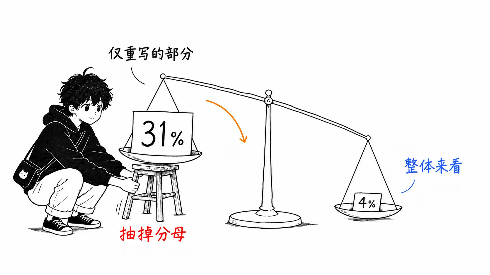
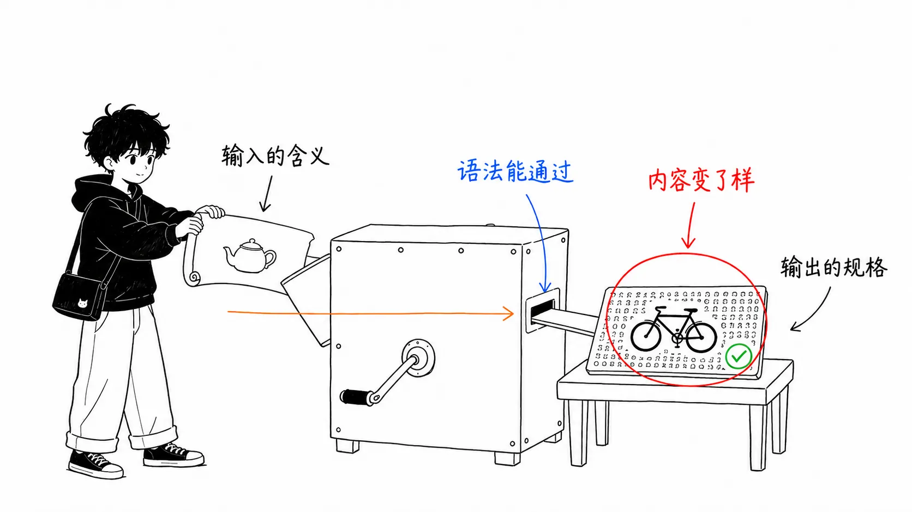
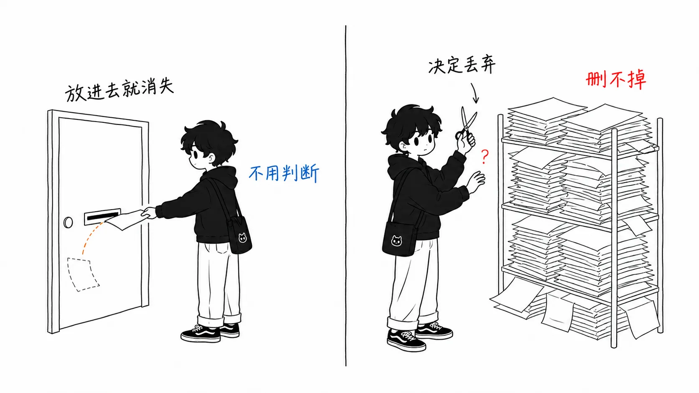

## 关于这篇文章

本文讨论的是 O'Reilly Radar 在 2026 年 8 月 17 日发布的 Markus Eisele 的文章《When AI Writes the Code, Specifications Need an Exit Strategy》。正文里明确写着，原文是对他的新闻简报 The Main Thread 上一篇文章的扩写和重写。

- 出处：[When AI Writes the Code, Specifications Need an Exit Strategy](https://www.oreilly.com/radar/when-ai-writes-the-code-specifications-need-an-exit-strategy/)（Markus Eisele，2026 年 8 月 17 日，18 分钟的文章）
- 原版：[The Main Thread — Spec-Driven Development Exit Strategy](https://www.the-main-thread.com/p/spec-driven-development-exit-strategy)

这篇文章分三部分。第 1 部分是 Eisele 的主张，第 2 部分是**我自己对照一手资料，核实他所引用的研究数字的经过**，第 3 部分是**我的看法**。第 3 部分最长。因为主张的介绍，读原文就够了。

先写清楚，我确认了什么、没确认什么。

确认过的：我按章节把 O'Reilly 的正文通读了一遍（图本身没看，只看了图注）。并且，我亲自取得了 Eisele 作为依据列出的 3 篇 arXiv 论文的摘要，和他的转述做了对照。第 3 篇里，正如后文所写，有一个数字对不上。

没确认的：The Main Thread 版的原文。参考文献里列出的 IBM Research 的实证研究、HumanLayer 的上下文工程文章，以及 Dexter Horthy 的演讲。还有 3 篇 arXiv 论文的正文（只看了摘要）。而最重要的是，我自己没有运营过“积累了 6 个月 spec-driven 智能体工作的仓库”的经验。下文里写到那种状态的地方，都是我的推断。

---

## 第 1 部分：Eisele 在说什么

### 先说结论

> 打开一个靠 spec-driven development 跑了 6 个月的仓库，会发现代码旁边又建起了另一个系统。需求、调研笔记、概要设计、详细设计、实现计划、任务清单、评审报告。代码上周二刚有过大改动，文档的最后更新却是几周前。所以规格书需要退出策略。写下的文字是为了增量（接下来要做的变更），发布后应当保留的事实，要晋升为原生的产物，其余的让它失效。

### “第二套代码库”

开头的一段话就是整篇文章。原文是这样开头的。

> Open a repository after six months of spec-driven agent work and you may find a second system sitting next to the code.

在此之上，Eisele 说这并不是新现象。软件和文档并行、各自生长，就他记忆所及，一直都是这样。就是我们以前称为瀑布的那套东西。周末读完一整个文件夹的纸质材料，周一就进项目的那种。他写道，那是“在管理上很完备，在工程上几乎无用”。

新的是速度。智能体能在很短的时间内把那堆过剩的文档重新生产出来。

他尤其视为危险的，是**让智能体生成规格初版的模式**。一次工作流运行，就从调研直接推导出需求、设计、计划，甚至把评审产物也堆在上面。看起来完成度很高，实际上需要评审、批准的材料大量增加。从混沌中造出真正的一致性，即使模型变快了也依然很难。

### 写下的文字是为了增量

处方是：必要的描述很短。预期的结果、非目标、与当前行为不同的约束、验收所需的证据。当新功能跨越架构边界，或引入代码中尚不存在的模式时，还要加上技术设计要素。他还写道，考虑回滚变更的成本也值得。因为如果现有系统里同一种模式有好几种实现，智能体再发明出一种的风险就很高。

调研笔记、原型、设计记录之类额外的散文，“只有在不确定性使其正当时”才加到项目里。**不能把它做成每个 pull request 的必经阶段。**

### 永久的事实，用原生的形式保存

这是我喜欢的、很具体的部分。Eisele 明言，说“晋升永久性约束”时，并不是要把所有决策都变成永久的 Markdown。那只是换个形式重蹈旧文档问题。对于大部分永久性事实，软件工程其实早就有了更好的存放处。

- API 的形态与兼容性 → OpenAPI、AsyncAPI、协议 schema、类型、兼容性测试
- 数据不变量 → 类型、DB 约束、校验、迁移检查
- 架构边界 → 模块结构、依赖规则、架构测试
- 可靠性要求 → 负载测试、SLO、遥测、告警
- 发布规则 → CI/CD 策略

然后是决定性的一句。

> A failed schema check or alert needs to be fixed and handled while the corresponding paragraph in an old design folder does not.

（schema 检查失败或告警，必须得到修复和处理；而旧设计文件夹里对应的那一段，则不必。）

自然语言也仍有它的职责。业务策略、权衡、架构依据。那些装不进可执行产物里的东西。但散文要短，并紧挨着它所说明的对象放置。只有在未来的团队会重复昂贵的调研、而代码注释又无法为实现提供正当性的时候，才值得留一份小型 ADR。

> Recording every local choice just hides the few decisions that matter and confuses the agents that are supposed to build the software.

（把每一个局部选择都记录下来，只会把真正重要的那几个决策藏起来，还会让本该构建这个软件的智能体感到困惑。）

### 五个步骤

他提出的运作模型就只有这些。

> 1. リポジトリの証拠から始める（既存の挙動を読む）
> 2. 意図したデルタ、重要な境界、既知の未知を記した小さな change brief を書く
> 3. リスクが要求する場合にのみ、調査・プロトタイプ・設計合意・強い検証を足す
> 4. 計画ではなく実装を読んでレビューする
> 5. リリース時に、一時的な推論を破棄し、生き残った事実をそれぞれのネイティブな正典成果物に保存する
>
> （1. 从仓库的证据出发（阅读现有行为）
> 2. 写一份小型的 change brief，记下预期的增量、重要的边界、已知的未知
> 3. 只有在风险需要时，才增加调研、原型、设计共识和强验证
> 4. 评审实现，而不是评审计划
> 5. 发布时，丢弃临时性的推理，把留存下来的事实分别保存进各自原生的权威产物）

他还引用了对 Research-Plan-Implement 的反思。把人工评审挪到实现之前的结果是，团队抱着长达 1,000 行的计划，工程师一边评审那份计划，一边把生成的代码几乎当作编译器输出来对待。实现可能偏离计划。

另外，“让智能体来判断”的部分，引用了 Simon Willison 2026 年 7 月 3 日的文章。这是 Claude Code 团队的一个启示：与其用分支表来规定该不该写测试，不如把判断本身交给智能体。

---

## 第 2 部分：对照一手资料核实数字

Eisele 以“这种行为有研究支撑”为由引用了 3 篇论文。3 篇的摘要我都亲自取了回来。

### “约 31%”的分母

原文的表述是这样。

> Choosing a more targeted repair approach around the identified defects (change brief) improved the results by roughly 31%.

对应的论文是 Jia 等人的《Automated Repair of Ambiguous Problem Descriptions for LLM-Based Code Generation》（arXiv:2505.07270）。它在 GPT-4o / GPT-4o-mini / DeepSeek-V3 / Qwen2.5-Coder-32B-Instruct 四个模型、HumanEval+ / MBPP+ / LiveCodeBench 三个基准上评估了名为 SpecFix 的工具。摘要中的相关部分。

> Without human intervention or external information, SpecFix modified 43.58% of descriptions, improving Pass@1 on the modified set by 30.9%. This yields a 4.09% absolute improvement across the entire benchmark.

Eisele 的“约 31%”**是对的**。不是误报。不过准确地说，SpecFix 改写的是全部描述的 43.58%，30.9% 是在这个被改写的子集上 Pass@1 的提升。放到整个基准上看，绝对提升是 4.09%。

31% 和 4.09%，都是同一个实验里的同一组数字。即便如此，留在读者脑中的画面是不同的。“有针对性地修复歧义，能好 3 成”和“有针对性地修复歧义，整个基准能好 4 个百分点”，在公司里争取预算时，能不能通过是两回事。这种分母，我在这两周里已经是第二次见到了。当一个数字不是假的、却容易引人误读时，我认为写的人应该用一个短语把分母附上。

顺带一提，迁移的数字也很有意思。针对某个模型修复过的描述，能让其他模型的表现提升 10.48%。这是**歧义不是某个模型特有的弱点，而是描述本身的缺陷**的证据。这直接支撑了 Eisele 的主张（brief 要短，但不能含糊），所以他没有引用，我有点意外。

### SWT-Bench 原样正确

> SWT-Bench found that generated tests could filter proposed fixes and double the precision of a software repair agent.

Mündler 等人的 SWT-Bench（arXiv:2406.12952）的摘要里，原样就是这么写的。

> we find that generated tests are an effective filter for proposed code fixes, doubling the precision of SWE-Agent

生成的测试是过滤所提议修复的有效手段，能让 SWE-Agent 的 precision 翻倍。Eisele 写“提议实现的智能体，不能是其需求和测试的唯一来源”时，依据就在这里。他的转述是准确的。

### TLA+ 的数字不是 27/9，而是 26.6/8.6

第 3 篇。《Can LLMs Write Correct TLA+ Specifications?》（arXiv:2606.05792）。Eisele 写的是“27% 的语法正确性，9% 的语义正确性”。摘要里的实际数字是这样的。

> LLMs achieve up to 26.6% syntactic correctness but only 8.6% semantic correctness, with successes exclusive to progressive prompting.

26.6% 和 8.6%。舍入的方向是往上，但差别不大。更重要的是内容。30 个模型、8 个系列，205 份 TLA+ 规格的数据集，25 个开放权重模型 × 4 种提示策略共 2,600 次运行，5 个专有模型 few-shot 共 130 次运行。用 SANY 解析器和 TLC 模型检查器验证。

而且有两个发现，我比 Eisele 看得更重。

> model size does not predict quality, e.g., DeepSeek r1:8b outperforms its 70B variant across all strategies

（模型大小并不能预测质量，例如 DeepSeek r1:8b 在所有策略下都优于其 70B 变体。）

> Code-specialized models consistently underperform due to negative transfer from mainstream language training.

（代码专用模型始终表现更差，原因是来自主流语言训练的负迁移。）

语法能通过的是 26.6%，语义正确的是 8.6%。这两个都是带“up to”的最佳值，把它们相除算出比例有些粗暴，但即便如此，**通过了解析器的规格，大半在通过之后说的是另一回事**这个量级感并不会动摇。因为这是一篇自己抱怨过分母的文章，所以我在这里注明，这只是个大致的参考。Eisele 把这一点总结为“形式化记法有助于发现错误，但不能保证正确性和对原意的保持”。我觉得这说得太含蓄了。这些数字说的是：把自然语言的意图“翻译”成机器可读形式的这道工序本身，目前几乎没有起作用。

而这在我看来，对第 1 部分的主张来说，是比 31% 强得多的论据。用 Markdown 把规格书写得厚厚的是浪费，不只是因为它会腐烂。而是因为**不存在一条能从厚厚的散文里、保持原意地落到形式化表示上的通路**。所以晋升的目的地，必须是不需要翻译的东西：类型、DB 约束、测试、CI 策略。Eisele 的清单全部由“不必翻译的东西”构成，这不该是偶然。

---

## 第 3 部分：我的看法：退出策略无法靠方针来实现

接下来才是正题。

Eisele 的五个步骤里，有四个只要写下来就会被执行。从仓库的证据出发。写 brief。按风险增加分量。阅读实现。全都是做的人自己能主动获益的行为。不写 brief，智能体就会失控；不读实现，就会出 bug。动机和行动是一致的。

只有第 5 步不同。

> At release, discard temporary reasoning and preserve each surviving fact in its native authoritative artifact.

**这是没有人能主动从中获益的行为。**而且被期待执行的时机，是发布这个注意力最不富余的时刻。

我以前写 GitHub Actions 注入事故的时候，见过同样的结构。“安全的写法”只作为代码的形状存在，没有任何地方在强制“为什么是这个形状”，于是在重写的过程中悄悄消失了。人工评审和 AI 评审都没发现。零配置的 linter 一下子就指了出来。当时的教训是“该守住的不是注意力，而是机器可读的规则”。

“发布时丢弃临时性的推理”，是**与那个方向正好相反的、同一个错误。**它把删除写成了依赖注意力的方针。

### 为什么扔不掉

我认为有三种摩擦在起作用。按我认为的轻重顺序。

第一。删除在评审里得不到称赞。一个删除 `docs/plans/2026-08-payment-refactor/low-level-design.md` 的 PR，要等到被打上“LGTM”，心理成本比添加它的 PR 更高。添加看起来是增加信息的行为，删除看起来是丢失信息的行为。实际上正相反：只要有一份腐烂的详细设计，就足以污染下一个读这个目录的智能体的判断，但这份损失不会出现在任何人的评审里。

第二。生成成本接近于零，反而抬高了删除的门槛。这是和 AI 之前不同的地方。人花三天写出来的设计书，看起来有三天的价值，所以难以舍弃。这个我能理解。可是智能体 40 秒生成的设计书，同样难以舍弃。理由调换了。不是“好不容易做出来的”，而是“把这么齐整的东西删掉，总觉得哪里不对”。排版整齐的 Markdown，不管内容对不对，都带着权威的外观。Eisele 写的“高完成度让一切看起来都受控、都有定义”说的是生成时，但同样的效果在删除时也在起作用。

第三。“智能体要读，所以留着”的误解。这是最容易遭到反驳的地方，所以先把它解决掉。“把规格书删了，下次智能体干活的时候不就没有上下文了吗”。

不会。下一个智能体该读的是代码、测试和类型定义。对于已发布的功能，实现计划是比代码更旧的信息源。Eisele 也写了同样的话：“发布之后，代码和生产环境的行为是系统做什么的一手证据。”尽管如此，如果仓库里有 `docs/`，里面有详细的散文，智能体就会去读。光是读倒也罢了，一旦和代码矛盾，它信哪一边就靠运气。**腐烂的规格书不只是吃掉上下文预算，还会主动撒谎。**

### 提案：不要把 brief 放进仓库

我的结论是这样的。

> 不要再把退出策略写成“发布时扔掉”这种运作规则。**一开始就把它放在不扔也会消失的地方。**

具体来说，把 change brief 的正本定为 pull request 的正文。不要把它作为仓库里的文件提交。

这样会有什么变化？brief 在变更进行期间是完全鲜活的。人和智能体都能读（用 `gh pr view` 就能取到）。评审的讨论也汇集在那里。而在合并的那一刻，它就自动变成了“过去某个 PR 的正文”。没有任何人做出删除的决定，它却已经从 `main` 的目录树里消失了。brief 原本带有的“这是对接下来要做的变更的说明”这个时态，由 Git 的结构来强制保证。

如果想放在工作中的 worktree 里，就把 `.brief.md` 写进 `.gitignore`。告诉智能体“brief 在这里，不过这是只限本次会话的文档，永久性的事实别写在这里”。这种做法我还没有长期运行过，所以这是提案，不是成果汇报。

而值得保留下来的事实，按 Eisele 的清单转到原生的形式里。这里重要的是，**做成机器能够确认晋升是否发生的形式**。“有没有写 ADR”这种检查清单项是不起作用的。我认为起作用的是这类东西。

- 给 `AGENTS.md`（以及 `CLAUDE.md`）设置行数上限，让 CI 在超限时失败。一旦撞到上限，就只能要么删减内容，要么把某条规则晋升为 linter 规则
- 检查 `docs/` 以下的 Markdown 所引用的标识符（类名、端点路径、配置键）在代码里是否真的存在。含有不存在标识符的文档，其腐烂的证据就变得机器可读了
- 对包含 API 变更的 PR，强制要求附上 OpenAPI 差异。堵住用散文写“注意向后兼容”的这条路

第三条已经有很多团队在做了。第二条，据我所知很少见。实现应该不难。连语法解析都不需要，只要把 `docs/` 里反引号内的字符串捡出来，用 `rg` 比对一下，我想就能找出 8 成腐烂的段落。

### 反过来，用方针就够的部分

为了公平，也写一下这个。第 3 步（按风险改变分量）最好不要做成机制。一旦在 CI 里强制这一步，它就会退回到 Eisele 所批评的“所有变更都经过同样的文档、评审和测试分类”的重量级方法。判断就让它保持为判断。Willison 所引用的“是否写测试，交给智能体自己判断更好”，说的也是同一回事。

把判断做成机制，就会变成官僚制。把删除交给判断，就会腐烂。该分开的就在这里。

---

## 只带走一件事的话

Eisele 这篇文章的价值，不在于“把规格书写薄一点”。这话以前就有人说过。价值在于，他给出了一份**“每一种永久性事实，其实早就有各自的权威存放处”**的清单。API 的形态放进 OpenAPI，不变量放进类型和 DB 约束，边界放进架构测试。散文只填补它们之间的缝隙。

在此之上，我想补一句。退出策略需要的不是扔掉的决心，而是**不扔也留不下来的存放处**。pull request 的正文，就是 Git 已经为我们准备好的那个地方。

关于一手资料也说一句。这篇文章里最有力的数字，我认为是 Eisele 谦逊地放在第 3 位的 TLA+ 的 8.6%。如果从自然语言到形式化规格的翻译保持原意的概率不到一成，那么写厚规格书这种行为的投入产出比，在腐烂之前就已经很差了。

---

## 参考文献

- [When AI Writes the Code, Specifications Need an Exit Strategy](https://www.oreilly.com/radar/when-ai-writes-the-code-specifications-need-an-exit-strategy/) — Markus Eisele，O'Reilly Radar，2026 年 8 月 17 日
- [Automated Repair of Ambiguous Problem Descriptions for LLM-Based Code Generation](https://arxiv.org/abs/2505.07270) — Jia, Morris, Ye, Sarro, Mechtaev，arXiv:2505.07270（初版 2025 年 5 月 12 日）
- [SWT-Bench: Testing and Validating Real-World Bug-Fixes with Code Agents](https://arxiv.org/abs/2406.12952) — Mündler, Müller, He, Vechev，arXiv:2406.12952（初版 2024 年 6 月 18 日）
- [Can LLMs Write Correct TLA+ Specifications?](https://arxiv.org/abs/2606.05792) — Bisharat et al.，arXiv:2606.05792，2026 年
- [Judgement](https://simonwillison.net/2026/Jul/3/judgement/) — Simon Willison，2026 年 7 月 3 日
