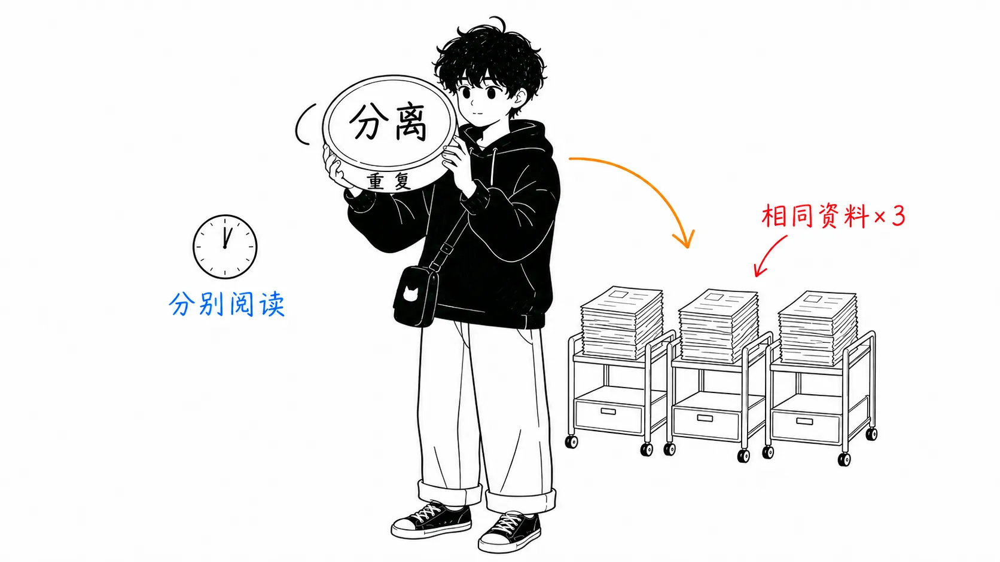
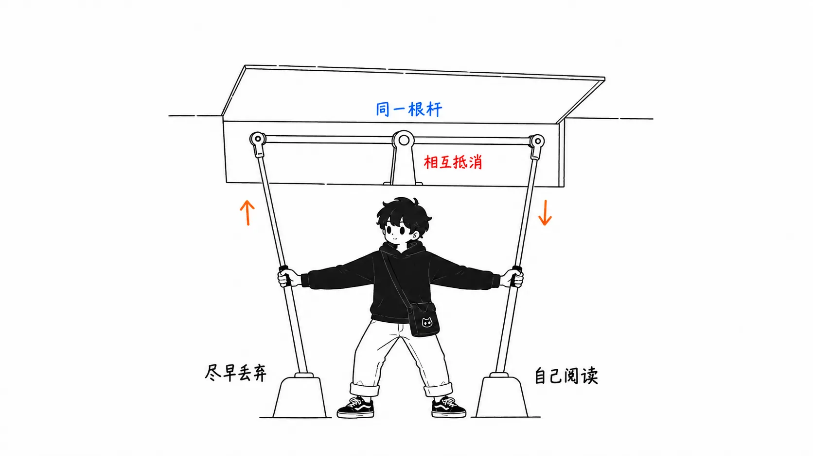
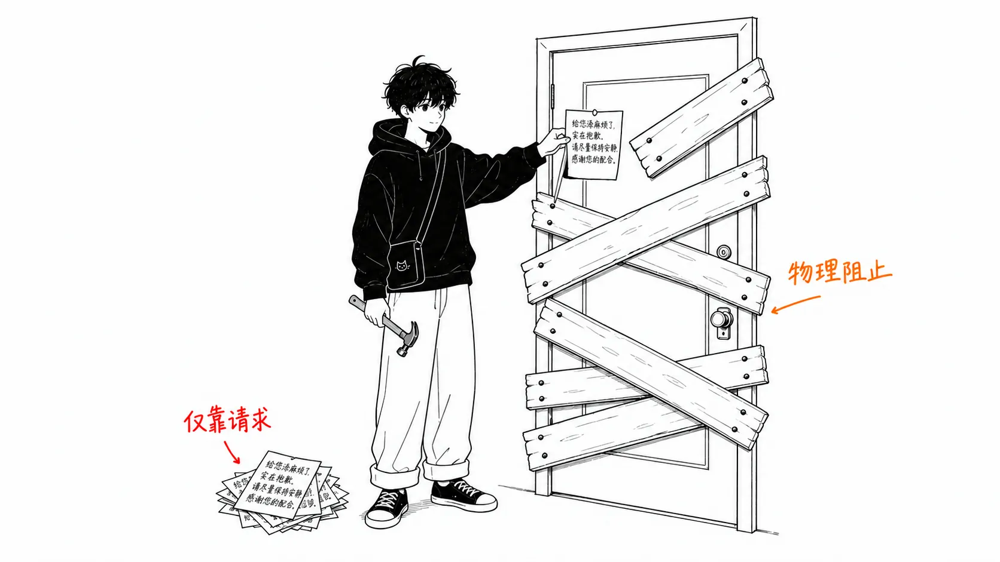

先说结论。

> 子智能体的“上下文隔离”和“重复读取”，不是实现上的缺陷，而是同一枚硬币的两面。买了隔离，就买了重复。实测中，47 次子智能体运行从大文件里读取的数据，**有 54.7% 是纯粹的重复**。而且重复读取的中位间隔是 **35 分钟**。如果父智能体自己去读，其中大半还留在它自己的上下文里。

## 关于这篇文章

我读了 Maurice Heumann（momo5502）那个实验的第二篇文章。他让一群 AI 智能体 24 小时不停地反编译《使命召唤：现代战争 2》（Call of Duty: Modern Warfare 2，2009）。

- 第 1 篇：[200 Billion Tokens Later: A Month of Letting AI Agents Decompile MW2](https://momo5502.com/posts/2026-08-17-mw2-decompilation/)（2026 年 8 月 17 日）
- 第 2 篇：[235 Billion Tokens Later: Auditing What The AI Agents Really Did](https://momo5502.com/posts/2026-08-22-mw2-decompilation-audit/)（2026 年 8 月 22 日）

第 1 篇是规模报告。连续四周不间断，199.8B token，约 7000 次提交，16,324 个函数里反编译了 5,588 个（约 34%）。他自己说这篇“几乎是一声求救的呼喊”，里面一条条列着牢骚：智能体总想在本地跑测试，躲开大的课题只挑小的捡，擅自说“上下文不够了”，等等。

第 2 篇则是**用约 2GB 的会话日志，审计那套配置实际是怎么运转的**。我觉得这篇更有价值。第 1 篇是使用感受，第 2 篇是实测。

先坦白一下。我手里没有 2GB 的日志，也没有复现这次审计。所有数字都引自原文。还有一点，原文的有些数字（1107.6 个智能体小时的明细、overseer 模型对比中的 bugs/hour）**只存在于图表里，没有落到正文中**，所以本文凡是需要提到的地方，只说一句“请看原文的图”。用猜测去填数字，危害更大。

## 先看规模

它是按订阅方式在跑，所以实际支付约 200 欧元。如果把同样的用量换算成 API 按量计费，是 **$85,207**。

| | Worker | Overseer |
| --- | --- | --- |
| 按量计费折算 | $70,275 | $14,933 |
| 工具调用 | 198,143 | 38,173 |
| 助手轮次 | 364,786 | 81,705 |

缓存读取约占 89%。24 小时不停地跑，这是理所当然的。

上下文方面的数字在这里。

| | |
| --- | --- |
| 压缩（compaction）总次数 | 269 |
| 压缩前的上下文大小（中位数） | 933,088 token |
| 两次压缩之间的轮次（中位数） | 1,346 |
| 两次压缩之间的时间（中位数） | 3.3 小时 |

它要用到 1M 窗口的 93% 到 100% 才压缩。也就是说，**几乎每一轮都在为接近 1M token 的缓存读取付费**。作者看到这个，把压缩阈值从 93% 降到了 60%。他的判断是：已经反编译完的函数，对之后的轮次基本无关，早点丢掉，性能应该几乎不变。

## 子智能体“测不出来”，所以他测了重复

这是正题。光这一节就值得去读原文。

先说前提。在这个项目里，**子智能体不能干实际的活**。它们没办法安全地并行改写工作区，每个都需要一个专用工作区。所以子智能体的职责只有调查并压缩结果，也就是防止父智能体的上下文被污染。

然后作者在这里卡住了。

> Measuring the effect is hard. The fact that they can't do real decompilation work already cuts their usefulness in half. The remaining question is how efficient they are at investigation.
>
> That's hard to measure too. But what we can measure instead is how much redundant data got pulled in because they don't share context.
>
> （效果很难衡量。光是它们不能做实际的反编译工作这一点，有用性就已经折半了。剩下的问题是，它们在调查上到底有多高效。
>
> 这同样很难衡量。但我们可以改为衡量的是：因为不共享上下文，到底多读进来了多少冗余数据。）

**“效率测不了，那就测重复。”**我认为，这一步怎么迈，是整篇文章最诚实的地方。针对 47 次子智能体运行，他把所有 5kB 以上的文件读取逐一对照，结果是：

- 大文件中有 **36%** 被多个子智能体读过
- 按读取量加权，**54.7% 是纯粹的重复**
- 最糟的例子是 `STATUS.md`。**21 个子智能体合计读了 28 次**（迁移到 GitHub issues 之前）
- 重复读取的**中位间隔是 35 分钟**

最后这一条才是真正的发现。作者也是这么写的。

> What matters is that the median time until a file is redundantly read by another subagent is 35 minutes. If the parent agent had done that investigation itself, the file would have stayed in its own context, and most of the redundant reads wouldn't have happened.
>
> （重要的是，一个文件从被读取到被另一个子智能体重复读取，中位时间是 35 分钟。如果父智能体自己做了那次调查，这个文件会留在它自己的上下文里，大部分冗余读取就不会发生。）

然后他把子智能体砍掉了。砍掉之后的产出：

| | 每天提交数 |
| --- | --- |
| 有子智能体 | 243.9 |
| 无子智能体 | 311.1 |

约增加 28%。不过作者自己也注明“用提交数当生产力指标未必准确”，结论也是这样收尾的。

> Whether subagents are useful, in this project or in general, is still hard for me to quantify. But I do have a feeling that (when lots of agents are launched in parallel) they can push token consumption up out of control, and that's reason enough to disable them.
>
> （子智能体到底有没有用，无论是在这个项目里还是一般而言，我仍然很难量化。但我有种感觉：（在大量智能体并行启动时）它们可能让 token 消耗失控地上涨，仅凭这一点，就足以成为禁用它们的理由。）

也就是说，原文的主张并不是“子智能体低效”。而是**“效率我没能测出来。测出来的是不可预测性，而它成了砍掉的理由”**。如果把这里概括成“重复 54.7%，所以是浪费”，就比原文的主张更强了。

## 我的看法

从这里往后，是原文里没有的、我自己的解读。

### 1. 35 分钟比 54.7% 更有分量

54.7% 只不过是“有重复”这个事实。重复是不是坏事，要看它能不能避免。决定这一点的，是 35 分钟。

子智能体的卖点是“不污染父智能体的上下文”。可是不污染，就意味着**父智能体知道的事，子智能体不知道**。这是同一句话。所以买下隔离的那一刻，就买下了重复。这不是实现粗糙，而是定义使然。

这样的话，“把子智能体做得更高效”这个方向，很大程度上是个不太靠谱的愿望。想在保持隔离的同时消除重复，近乎于想在不共享的前提下共享。我认为原文的 35 分钟，就是给这个矛盾贴上价签的数字。

反过来说，**只有当污染的成本大于重复的成本时，隔离才值得付钱**。这个判断随任务而变，而作者的项目里，“子智能体不能干实际的活”这个限制从一开始就在起作用。所以这不是能原样搬到其他项目的结论。

### 2. 作者的两项调整，大概会互相抵消

原文里让我卡住的是这里。同一篇文章里，并排放着这两项调整。

- 压缩阈值从 93% **降到 60%**（更早丢弃上下文）
- **禁用**子智能体（调查放在父智能体的上下文里做）

废除子智能体的依据是“父智能体自己读的话，35 分钟内应该还留在上下文里”。这个依据**以父智能体的上下文能撑 35 分钟为前提**。

而把压缩降到 60%，父智能体上下文的寿命会变短。按原文的数字，它用到 93% 才压缩，中位每 3.3 小时一次。如果在 60% 就切，简单算一下，间隔应该会比这短不少。是否会短于 35 分钟，不可能与上下文的增长速度无关。

也就是说，提前压缩**有可能把本该因废除子智能体而消失的重复读取，以父智能体自己重新读取的形式找回来**。原文没有提到这种相互作用。两者单独看都合理，组合起来效果却可能互相吞噬。

这是我的推断，不是验证结果。作者写了“下一篇会给出结果”，我想答案会在那里出来。我想看的，是压缩改成 60% 之后**父智能体的重复读取率**。如果它上升了，那么本文的“35 分钟”之论，就成了阈值的函数。

### 3. “评审者的模型起作用”更容易迁移

原文里还有一个结果，不如子智能体的话题那么显眼，但通用性更高。

让 Opus 5 和 Sonnet 5 各约一半作为 worker 来跑的对比：

| 模型 | 构建尝试 | 失败率 | 提交/小时 |
| --- | --- | --- | --- |
| Sonnet 5 | 5,826 | 9.1% | 6.1 |
| Opus 5 | 9,868 | 23.9% | 1.6 |

Opus 更容易把构建搞坏。搞坏了就得修。修了，提交就推进不动。不过作者自己踩了刹车：“未必是 Sonnet 更优秀。也许只是它挑了简单的任务。”

于是他把 overseer（评审每一次提交的另一个智能体）的模型也换了，按 worker × overseer 的组合统计“被标记的 bug”。按每小时算，Opus worker 的 bug 更少。但 Opus 的提交本身就少。所以换算成**每次提交**，两者的失误率差不多一样。差别出在 overseer 一侧，结论是这样的。

> What matters is the reviewer's model, not the worker's model.
>
> （起作用的是评审者的模型，而不是 worker 的模型。）

（这一节的数值在原文的图表里。正文没有写出来，准确数值请看原文。）

这和我们凭直觉的配置正好相反。通常我们是“让好模型来写，用便宜的模型来检查”。这个结果暗示的恰恰相反。

不过我觉得，把这一行原样带走是危险的。因为指标是“被标记的 bug 数量”。Sonnet overseer 标记得多，也许只是因为它是个爱挑毛病的模型。**标记是否正确，并没有被衡量。**关于 overseer 整体的准确度另有一组数字：在提到提交的 2177 条 Discord 回复中，1172 条无法分类，354 条指出了明确的 bug。在能分类的部分里，约占三分之一。不算差，但要让“标记数多的评审者更好”这个说法成立，还不够。

即便如此，我仍然看重这个结果，因为**它给了我们一个理由，去怀疑那些在评审者身上抠成本的设计**。我自己的 Claude Code 设置，恰恰就偏向“评审用轻量模型就行”（`~/.claude/rules/performance.md` 里写着 "If it only reads/searches, use haiku"）。至少，把评审当作廉价的只读工作来对待，值得重新考虑。

### 4. CLAUDE.md 是软指令

原文的结论里有这样一行。

> Soft instructions don't work very well. Mechanical blockers are more effective for enforcing rules.
>
> （软指令不太管用。要强制执行规则，机械式的拦截更有效。）

这是在回收第 1 篇的伏笔。第 1 篇里，作者**反复说过**“别在本地跑测试，不是有 CI 吗”，智能体就是不听。第 2 篇的对策是这些。

- 在代码一侧**禁用了测试执行**（只在复现 CI 失败和新增测试时允许运行）
- 把 Release 构建的 warnings-as-errors 挪到了 Debug 构建的 CMake 选项里（构建时间减少 30%）
- 为了让它们别再轮询 CI，改成用 GitHub webhook 通知失败
- 为了让它们别再去确认 Issue 有没有关闭，在提交信息里写上 `Fix #N` 让它自动关闭

全都是从“嘴上说服”转向“只让它只能那么做”。顺带还出现了一个数字：PowerShell 的错误率是 17%（其他工具基本都在 2% 以下），作者写道“禁止执行 PowerShell 也许是合乎逻辑的结论”。也是同样的思路。

我读完去看了自己的 `CLAUDE.md`。那里面全是软指令。“先写测试”“不要擅自提交”“token 预算是 4000”。全是请求。强制力为零，能不能被遵守，取决于模型的心情，以及中间经历了几次压缩。

而 Claude Code 里其实有正经的强制机制。hooks（用 PreToolUse 拦下）、settings.json 的 deny 列表、权限模式。**如果有想让它遵守的规则，该写的地方不是 CLAUDE.md，而是 settings.json。**这是作者做了四周实验后走到的结论，说实话，我认为这是这两篇文章里最实用的一行。

## 只带走一件事的话

不是关于子智能体的。

**想让它遵守的规则，要写在机器会拦截的地方。**写在请求该待的地方的规则，到第 10 次压缩就消失了。

关于子智能体，如果还要补一件事：在决定砍不砍之前，先数数自己的重复读取。全都留在 `~/.claude/projects/**/*.jsonl` 里。作者读了 2GB。我们用小得多的日志，也能回答同样的问题。

## 出处

- Maurice Heumann, [235 Billion Tokens Later: Auditing What The AI Agents Really Did](https://momo5502.com/posts/2026-08-22-mw2-decompilation-audit/), momo5502.com，2026 年 8 月 22 日
- Maurice Heumann, [200 Billion Tokens Later: A Month of Letting AI Agents Decompile MW2](https://momo5502.com/posts/2026-08-17-mw2-decompilation/), momo5502.com，2026 年 8 月 17 日

文中的数值全部引自上述两篇。我本人没有复现日志审计。原文的部分数值（智能体小时的明细、overseer 模型对比中的 bugs/hour 和 bugs/commit）只存在于图表内，所以本文没有引用具体数值。“我的看法”的第 2 条是我的推断，不是验证结果。
