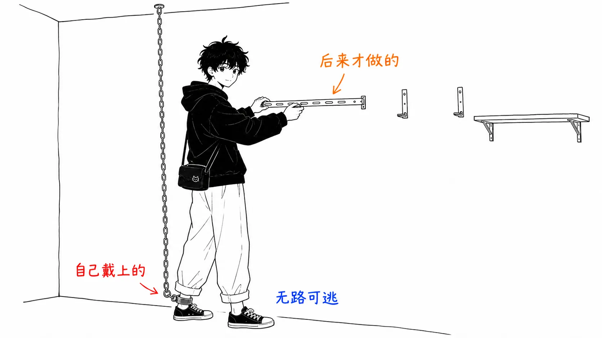
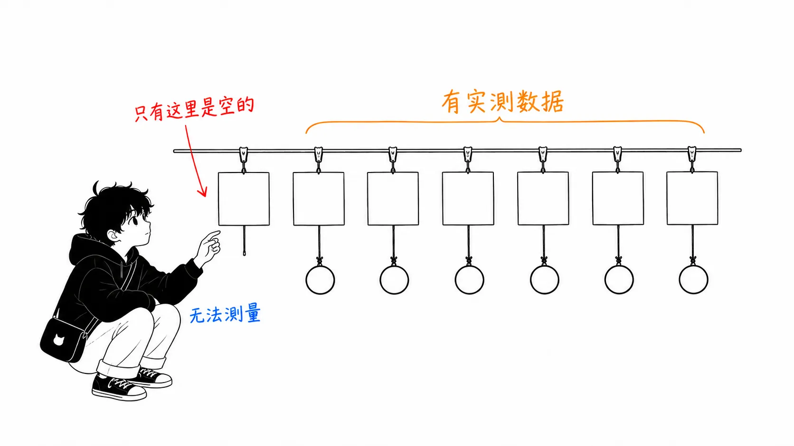
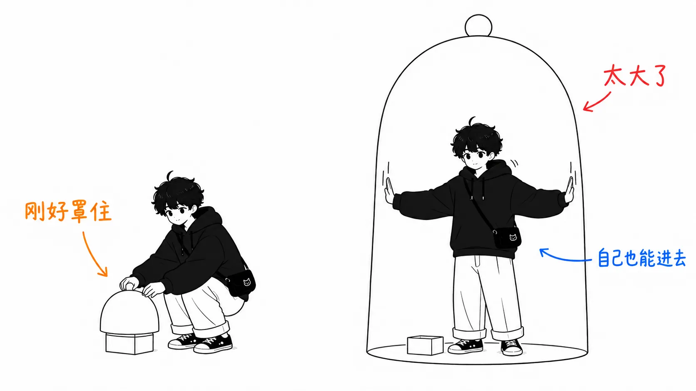
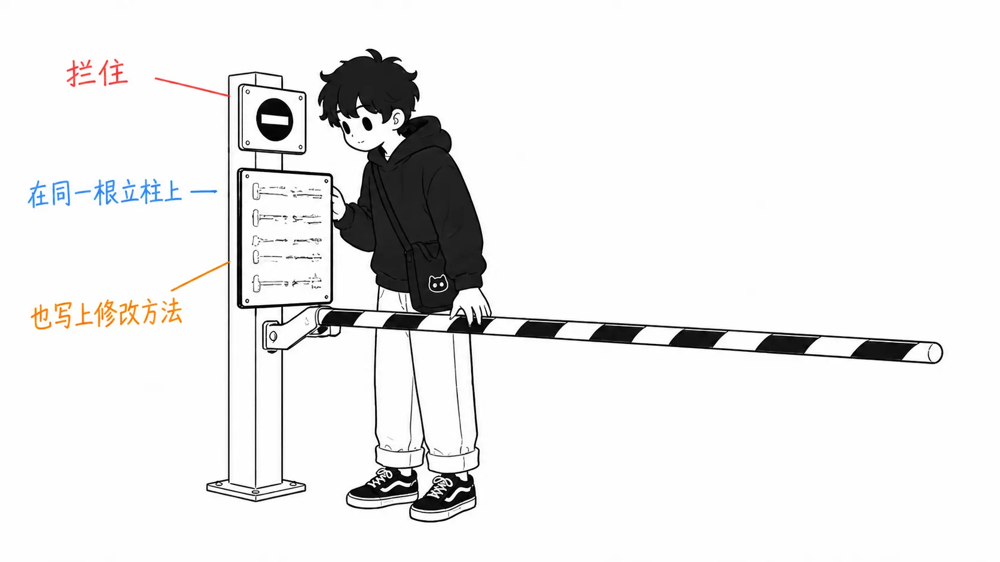
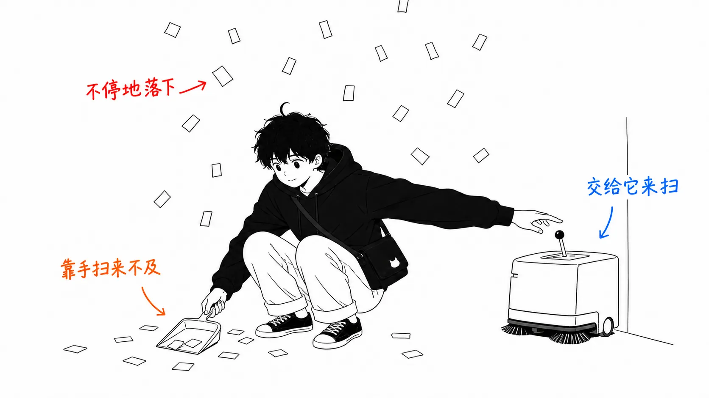

先说结论。

> 我读了一篇讲“harness engineering”的解读文章，又回到它引用的一手资料去看，发现**摘要里漏掉的不是某个条目，而是一条约束**。OpenAI 做的是一个**刻意设定**了“手写代码 0 行”的实验，那七件待办事项，是从这条约束倒推出来的结论。如果没有约束，只照搬条目，大概既不知道先后顺序，也不知道优先级。顺便说一句，这条约束还带着适用条件，原文自己就写了：“在低吞吐的环境里，这样做是不负责任的。”

## 关于这篇文章

起因是我在 X 上刷到的一篇文章。

- 解读文章：[Harness Engineering: How to Build AI Agents That Don't Fall Apart](https://x.com/i/article/2093441687989186560)，rari（[@0xwhrrari](https://x.com/0xwhrrari/status/2093685107534000560)），2026 年 8 月 29 日
- 一手资料 1：[Harness engineering: leveraging Codex in an agent-first world](https://openai.com/index/harness-engineering/)，OpenAI，2026 年 2 月 11 日
- 一手资料 2（解读文章所引用）：Anthropic, Harness design for long-running application development

解读文章的主张是：agent 出问题，原因不在模型的智力，而在**周围的环境（也就是 harness）**，并列出了生产环境的 harness 该做的七件事。我觉得整理得不错，这些东西有了名字，本身就有价值。

先坦白两点。**解读文章的正文里有大量图片块，我没能读到**（文章最大的卖点，也就是清单本体，就在图片里）。我读到的只有文本块。另外，Anthropic 那篇一手资料我没读过，只把它当作“转引的转引”来对待。

而 OpenAI 的文章，我读的是原文。读完之后，事情的面貌变了。

## 解读文章说的七件事

先只列骨架。

1. **把请求变成契约**：行动之前，先把需求转换成有边界的对象
2. **给一张地图**：不是把全部文档都给它，而是一份小小的 root guide，告诉它该去哪里看
3. **在正确的环境里提供正确的工具**：目的、可预测的输出、明确的失败状态、权限边界
4. **把记忆外置为持久状态**：对话不是记录的正本
5. **自主之前先装传感器**：看不见的东西就修不了
6. **在模型之外强制执行权限**：模型可以提议，授权由 harness 来做
7. **记录 trace，并做局部恢复**

整篇文章的主张是这个。

> Prompt engineering 告诉模型要做什么
> Context engineering 决定模型能看到什么
> **Harness engineering 构建模型行动所处的世界**

我没有异议。只是它没有写七件事里该先做哪一件。决定这一点的，是一手资料里的那条约束。

## 一手资料里有、摘要里没有的东西

OpenAI 的文章开头是这样宣告的。

> 过去五个月，我们的团队一直在做一个实验：构建并交付一款软件产品的内部 beta 版，而且**手写代码 0 行**。

紧接着的下一句，决定了整篇文章的设计。

> **我们是刻意选择这条约束的。** 因为它会逼着我们去构建那些能把工程速度提升若干个数量级所必需的东西。

也就是说，“0 行”不是在炫耀成果，而是**他们给自己加的束缚**。既然不能手写，就没有“卡住时让人类代写”这条退路。于是每一次，只能这样发问。

> 出问题的时候，修复方式几乎从来不是“再努力一点”。因为往前走的唯一办法是让 Codex 去干活，所以人类工程师总会介入任务，然后问：“**缺的是哪项能力？怎样才能让它对 agent 既可读、又可强制执行？**”

这个“因为堵死了退路，所以只能去修环境”的先后顺序，在解读文章的七个条目里没有出现。七个条目是结论，不是动机。

规模也写一下。五个月，约 100 万行，约 1,500 个 PR，每位工程师每天 3.5 个 PR，团队从 3 人扩到 7 人。估算耗时约为手写的十分之一。

而且**适用条件也写得明明白白**。这一点对我触动最大。

> 这个仓库以最少的阻塞合并的关卡来运行。Pull request 的生命周期很短。测试的 flake 多半靠重跑来处理，而不是无限期地卡着。在 agent 的吞吐量远超人类注意力的系统里，**纠正很便宜，等待很贵**。
>
> **这在低吞吐的环境里是不负责任的。** 而在这里，它往往是正确的取舍。

他们明确说了，自己的做法只在特定条件下成立。摘要恰恰会把这一点漏掉。漏掉之后，剩下的就只有一句“减少合并关卡”，而这句话视条件而定，是完全可能出事故的。

## 给七个条目标上“价格”

接下来是我自己的工作。这两周我碰巧接连读了几篇话题相近的文章，所以我把解读文章的七个条目逐一对照，看“哪份一手资料里有实测数据”。

| 解读文章的条目 | 对应的一手资料及其内容 |
| --- | --- |
| 1. 变成契约 | **没找到**（见后文） |
| 2. 给一张地图 | OpenAI：`AGENTS.md` 是一张**约 100 行**的地图。细节放在结构化的 `docs/` 里，那里才是正本 / Uber：AI 上下文图（2,400 万个节点、8,000 万条边）。一个有依据（grounded）的 agent 用 38 秒回答的问题，没有依据的那个花了 20 分钟还答错了 |
| 3. 正确环境里的正确工具 | Uber：100 个工具的 schema 有 **5 万到 7 万 token**，每一轮都重发 → 通过 CLI 解析和工具搜索把它们从上下文里排除，code-mode 削减了 50% 到 90% |
| 4. 记忆变成持久状态 | OpenAI：让仓库知识成为 system of record / Warp：通过 PR 更新 skill 文件 / momo5502：`STATUS.md` 膨胀到超过 10MB，撑爆了上下文，于是迁移到 GitHub issues |
| 5. 自主之前先装传感器 | OpenAI：把 Chrome DevTools Protocol 接入 runtime，每个 worktree 都有独立的可观测性栈。**因为可以用 LogQL / PromQL 查询，“启动要在 800ms 以内”才成了一条可执行的指令** / Cainex：golden set 和回测 |
| 6. 权限放在模型之外 | momo5502：说了四个星期它也不听，于是在代码层面禁用了测试执行 / TokenOps：“不想让被管控的对象来决定自己要不要被叫停”，所以不把模型放在 enforcement 路径里 |
| 7. trace 与局部恢复 | Uber：会话分析仪表盘能检测出 **16 种反模式**，并附上金额 / momo5502：审计了 2GB 的会话日志 |

七项中有六项，都摆着规模不一的多组实测数据。**而只有第 1 项是空白。**

这也许是我搜得不够。但我可以猜一下为什么会空着。因为**没有办法衡量“任务有没有被悄悄重新定义”**。另外六项全都能落到可计数的量上（token、时间、次数、金额）。而契约有没有被遵守，落不下来。要检测出 agent“完成了另一项工作，还宣称成功了”，需要有人来判断最初的需求究竟是什么。到目前为止，这个“人”还是人类。

有意思的是，**这个无法衡量的条目，在解读文章里被放在了第一位**。就顺序而言我觉得是对的（没有契约，就不知道其余六项在守护什么）。但是，把一个拿不出实测数据来推动的条目放在最前面，对读者决定“先做什么”并不起作用。换成我，会从第 3 项（整理工具和上下文）开始，因为它的效果今天就能数出来。

## 唯一一句谈到比例的话

解读文章里，我觉得分量最重的是这一句。

> **harness 应该比它所控制的故障面更小**（The harness should be smaller than the failure surface it controls）

其他的表述都是“应该做某事”，只有这一句说的是“做到什么程度”。而且还可以反过来用：**当 harness 比故障面还大，harness 本身就成了新的故障面。**

这不是抽象的说法，我刚好看到过一个实例。读 Warp 的自我改进 skill 循环（收集反馈，由改进 agent 针对 base skill 提交 diff PR 的机制）时，自动化只做到起草 diff 为止，之后由人类审查、合并。也就是说，那套机制**多出了一条 review 队列**。在几百人每天处理几千个 code review 的组织里，这是划算的。如果是一个人在做，多出来的那条队列，可能比原来的故障面还大。

同样的判断也适用于 OpenAI 这边。他们的 harness 很庞大（一组自定义 linter、结构测试、每个 worktree 一套的可观测性栈、CDP 接线、后台清理 agent）。但它所控制的故障面更大（100 万行、1,500 个 PR、手写 0 行）。就比例而言，是成立的。

解读文章把这一句和其他主张一视同仁地放在了中间。我认为这里才是结论。

## 最小、也最容易照搬的一条

从 OpenAI 的文章里，如果只挑一件不论规模明天就能做的事，就是这个。

> 因为 lint 是自定义的，所以 **我们把错误信息写成会向 agent 的上下文注入修复指引的样子**（we write the error messages to inject remediation instructions into agent context）

lint 失败的时候，agent 读到的是错误信息。如果它只写到“违反命名规范”就结束，agent 只能靠猜来改。如果它接着写“这种情况请遵循 X，改成 Y”，一次就能改对。**错误信息直接成了向 agent 下达指示的通道。**

这也和我之前读到的一个说法对得上：“想让人遵守的规则，别写在拜托的地方，而要写在机器会拦住的地方。”但如果只是机器拦一下，agent 并不知道为什么被拦。这句话的内容是：**在拦截的地方，把原因和修法一起写上。** 把关卡和教材放在同一个地方。

OpenAI 的文章里还有一句，是同一种想法的泛化。

> 当文档不够用时，**就把规则升格为代码**（When documentation falls short, we promote the rule into code）

“升格（promote）”这个词很好。不是往上再多写几句，而是把它所在的位置提上去。

## 熵的那段话，大概是最有切身感的

最后，是解读文章里没有、OpenAI 的文章里有的一段，朴素，却很真切。

> Codex 会复制仓库里已经存在的模式，**包括参差不齐的、并不最优的那些。** 随着时间推移，这必然会导致漂移。
>
> 起初，人类靠手工处理这个问题。**我们的团队曾经每周五（一周的 20%）都用来清理“AI slop”。** 不出所料，这没法规模化。

一周的 20%。而他们的对策不是增派清理人手，而是把“golden principles”写进仓库，让在后台运行的清理 agent 定期扫描，找出偏离的地方，再开出小的修复 PR。大多数一分钟内就能审完，并自动合并。

原文把这称为 **garbage collection**。还把技术债比作高利贷，说与其集中痛苦地一次还清，不如持续、少量地还，几乎总是更好。

我之所以引这一段，是因为“**agent 拿自己产出的东西当教材，越学越差**”这个观察，我在别处不太见到。人类团队里也会发生同样的事，但复制的速度不一样。我想，周五的那 20%，就是这个速度开出的账单。

## 只带走一件事的话

**读完摘要之后，回到一手资料里去找那条约束。**

这次漏掉的不是条目。七个条目被准确地概括了。漏掉的，是决定了“为什么是这七个”的约束（手写 0 行），以及这条约束成立的条件（高吞吐环境）。

没有约束，只拿到条目，得到的就是一张清单。清单不坏，但**你不知道先后顺序，也不知道哪些情况下可以不做**。我之所以能发现七项里第 1 项没有实测数据，也是因为把一手资料摆在了一起。

如果再补一句，那就是把解读文章里那句话，套到你自己的 harness 上。**它，比它所控制的故障面小吗？**

## 出处

- rari（@0xwhrrari），[Harness Engineering: How to Build AI Agents That Don't Fall Apart](https://x.com/i/article/2093441687989186560)，X Article，2026 年 8 月 29 日
- OpenAI，[Harness engineering: leveraging Codex in an agent-first world](https://openai.com/index/harness-engineering/)，2026 年 2 月 11 日
- Anthropic，Harness design for long-running application development（解读文章所引用，我未读）
- 对照表中参考的文章：Uber Engineering [Running a Software Factory Efficiently at Uber Scale](https://www.uber.com/us/en/blog/efficient-software-factory/)（2026 年 8 月 27 日）/ [How Warp builds self-improving agents on Claude](https://claude.com/blog/how-warp-builds-self-improving-agents-on-claude)（2026 年 8 月 26 日）/ Maurice Heumann [235 Billion Tokens Later](https://momo5502.com/posts/2026-08-22-mw2-decompilation-audit/)（2026 年 8 月 22 日）/ Chawla & Koul [Who spent all the tokens?](https://commandline.microsoft.com/tokenops-real-time-run-scoped-cost-control-ai-agents/)（2026 年 8 月 13 日）/ [The Claude Code guide for startups](https://claude.com/blog/claude-code-guide-for-startups)（2026 年 8 月 20 日，Cainex 的案例）

解读文章的正文，我只读了去掉图片块之后的文本部分（文章里的清单本体在图片里，我没有确认）。Anthropic 的一手资料我没有读。“给七个条目标上‘价格’”一节的对照表，以及对第 1 项为何空白的猜测，是我自己的工作，不是任何原文的主张。
