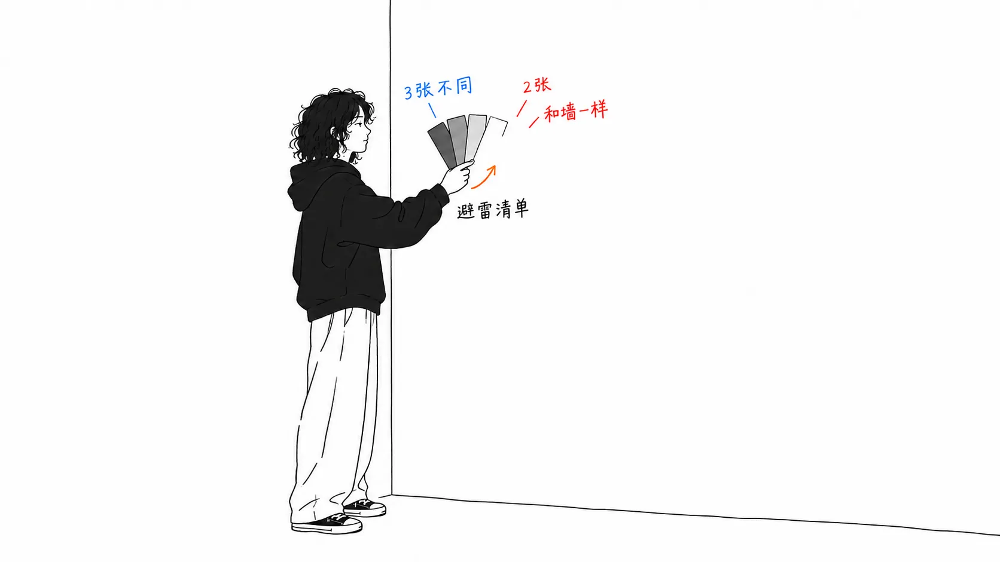
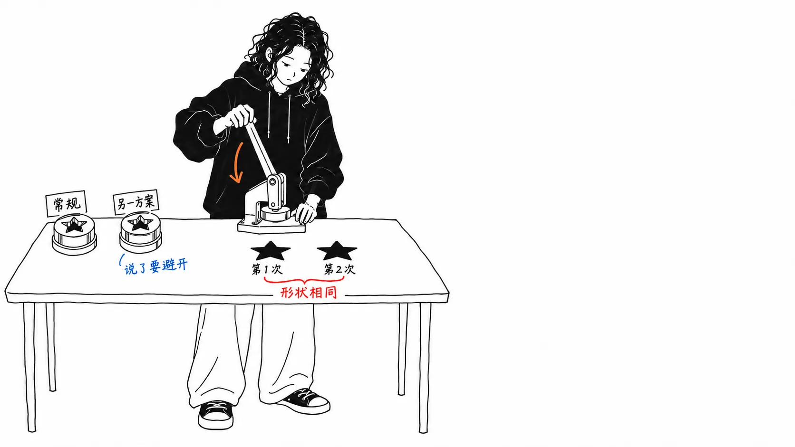
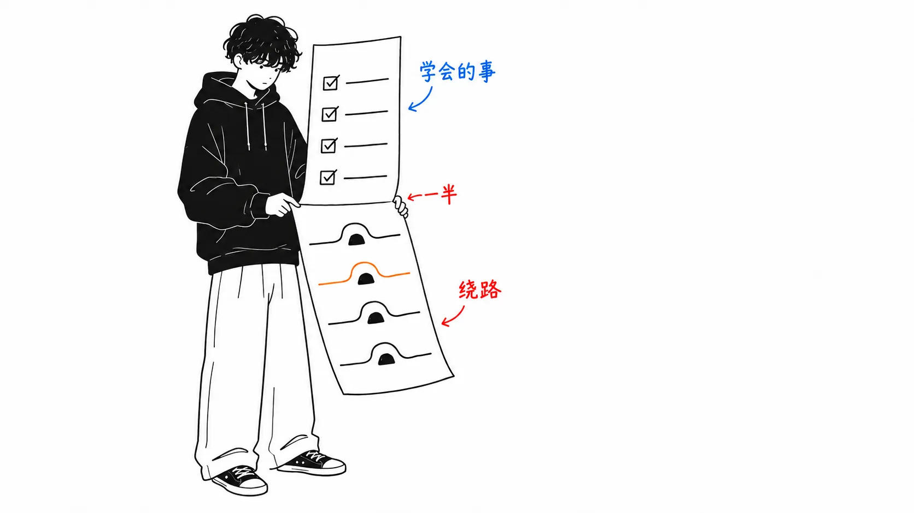

先说结论。

> 指南里有一节，说提出设计需求时，要用具体名称列出“希望避开的外观”。列出的5个里，**有2个就是刊载这篇文章的网站自己的外观**。奶油色背景 `#faf9f5`（浅色模式时），以及 monospace（等宽字体）的标签。两者都是 anthropic.com 也在用的**自家风格**。所以“避免千篇一律的外观”这种指令没用是理所当然的，因为**对模型来说，那不是千篇一律，而是默认值**。

## 关于这篇文章

我读的是 [claude.dev 的 Playbook《Getting the most out of Opus 5.5 in Claude and Claude Code》](https://claude.dev/blog/getting-the-most-out-of-opus-5-5/)（2026年9月22日，9分钟）。作者署名 Addy Osmani，审校是 Molly Vorwerck。

先确认来历。光看 `claude.dev` 这个域名，像是非官方的，但**它是官方的**。页面的 JSON-LD 里明确写了 publisher。

```json
"publisher": {"@type":"Organization","name":"Anthropic","url":"https://www.anthropic.com"}
```

而且 Opus 5.5 本身也确实存在。[anthropic.com/claude-opus-5-5](https://www.anthropic.com/claude-opus-5-5)“Introducing Claude Opus 5.5”的日期是**同一个9月22日**。也就是说，这份 Playbook 是发布当天的指南。

**坦白交代一下。** 我还没用过 Opus 5.5。我验证的只有能从外部确认的东西（域名的来历、发布日期、网站的 CSS）。**文章里没有明确写作者的所属。** 他是 Anthropic 的人还是外部投稿，我从页面上判断不出来。

## 在发布方的 CSS 里找“该避开的5样”

设计那一节写得不错，我引用一下。

> With no design direction, Opus 5.5 falls back on a few default styles. **A general instruction like "avoid a generic look" mostly swaps one default for another.** A list of specific patterns works much better.

（没有设计方向时，Opus 5.5 会退回到几种默认样式。像“避免千篇一律的外观”这样的一般性指令，**多半只是把一个默认值换成另一个默认值**。列出具体的模式，效果要好得多。）

然后它列出的5个是这些。

> Don't use a **cream or off-white background**, **italic accent words in headings**, numbered **"01 / 02 / 03" section labels**, **monospace labels**, or **pill-shaped buttons**.

读的时候我心里一动。**这5个，好像在哪儿见过。** 就在刊载这篇文章的页面本身。我把 CSS 下载下来查了。

| 列出的模式 | claude.dev 的 CSS |
| --- | --- |
| 奶油色／米白色背景 | **符合**。在 `@media (prefers-color-scheme:light)` 下有 `--bg:#faf9f5`、`--bg-raised:#f1efe8`、`--bg-panel:#ece9e0` |
| monospace 标签 | **符合**。带 `font-family:var(--mono)` 的规则有 **100条**。选择器包括 `.label`、`.mono`、`.tabs`、`.meter`、`.nav-brand` 等 |
| 标题里的斜体强调词 | 没找到（`font-style:italic` 只有2处） |
| 胶囊形按钮 | 没找到（符合的 `border-radius` 只有2处） |
| “01 / 02 / 03”的章节编号 | **不符**。这个网站用的是“1. / 2. / 3.”的形式 |

**5个里中了2个**。不是全部。但中了的这2个，分量很重。

`--mono` 的定义是这样的。

```css
--mono: "Anthropic Mono", ui-monospace, "SF Mono", Menlo, monospace
```

**Anthropic Mono**。他们有自家的等宽字体，并且把它用在标签上。

保险起见，我也看了正牌的网站。

| 网站 | `#faf9f5` | `#141413` | "Anthropic Mono" |
| --- | --- | --- | --- |
| claude.dev | 浅色模式的 `--bg` | 默认的 `--bg` | 在 `--mono` 里定义 |
| anthropic.com/claude-opus-5-5 | 37次 | 50次 | 1次 |
| anthropic.com（首页） | 8次 | 13次 | 3次 |

`#faf9f5` 和 `#141413` 在3个网站上都出现了。**这是品牌色。**



## 所以“避免千篇一律”没有用

这里才是正题。指南写道“一般性指令只是把一个默认值换成另一个默认值”，这话没错。但它没写**为什么会这样**。看了 CSS 就能解释了。

对模型来说，那5个并不是“千篇一律”。它们是**默认值**。周围一直都是这个样子的东西，它没法把它认作坏东西。被告知“避免千篇一律的”时，模型并不认为自己的默认值是千篇一律，于是判断别的什么东西才是千篇一律，去避开那个。结果，一个默认值被换成了另一个默认值。

所以列出具体名称才有效。这等于**从外部把“这是默认值”这条信息递给了它**。

换句话说，那5个并不是品位差的外观。恰恰相反，它们很规整。规整的东西成了默认值，问题出在它是默认值，而不是丑。**“AI 味的设计”的真面目，大概不是笨拙，而是千篇一律。**

这和我自己这个月栽的跟头，完全是同一个形状。当这个博客的标题45篇全都成了同一个模子的时候，单看每一篇，没有一篇是不好的。照着规则做就会出同一个形状，而“形状相同”本身并不违反规则，所以从内部检测不出来。



## 14天前测出来的东西，变成了检查清单

指南开头3条里的第2条是这个。

> Delete "think carefully" lines. Opus 5.5 already thinks before every reply.

（删掉“仔细想”这类句子。Opus 5.5 在每次回复之前本来就会思考。）

卷末的检查清单里也有。“No "think hard" lines in prompts or saved instructions”。

这让我想起读 Anthropic 在9月8日发的降低成本那篇文章时的事（[我的文章](https://meikocho1.github.io/blog/claude-official-cost-down)）。那是一个埋入6种反模式再去测量的实验，其中2种是 **verification rituals（“验证两遍”）** 和 **thoroughness boosters（“请极尽彻底”）**。清理的结果是成本 −14.6%，正确率 +5.3%。

**14天后，它成了产品指南里的检查清单。** 9月8日是“测了之后是这样”，9月22日是“请删掉”。从测量到指导，两个星期。

这次指南一方给出的依据是这样写的。

> In our testing in a chat product, removing a "think carefully" line made replies start sooner, with **no clear drop in quality**.

（在我们于聊天产品中的测试里，删掉一句“think carefully”，回复开始得更早了，**质量没有明显下降**。）

“没有明显的质量下降”。9月8日那篇连置信区间都附上了，所以那篇更严谨。不过说的是同一件事，这篇是从使用方的角度写的。

## 一半是应对办法，最重的一条在第5节

再说一点。这份指南由大约18个“What to do”构成，分开读的话，有**两种**。

**新近变得可以做的事**（整个丢给它让它跑、拆给子智能体、直接贴图、让它找长资料里的矛盾、以成品文件来接收、让它做评审）。

**对新行为的应对办法**（删掉“think carefully”、列出想避开的设计、在 `CLAUDE.md` 里写“别停，继续往下做”、把任务清单放进文件、在项目指令里写“已经有答案的别再翻出来重提”、删掉要求披露推理过程的句子）。

大致是一半对一半。分类带有主观成分，所以我不给数字，但**标题叫“榨出更多”的东西，有一半是在避开新的摩擦的步骤**。

而最重的一条在第5节。

> Opus 5.5 is the first Opus model to launch with Fable-level bio and cyber safeguards. In Claude apps and Claude Code, **most flagged messages move to an older model, and your work goes on there.**

（Opus 5.5 是第一个上线即带有 Fable 级别生物与网络安全防护的 Opus 模型。在 Claude 应用和 Claude Code 中，**大多数被标记的消息会转到较旧的模型，你的工作在那里继续进行**。）

一旦被标记，**就会转到旧模型，工作就这样继续下去**。在 Claude Code 里，用 `/model` 切回来，在 `/config` 里改“Switch models when a message is flagged”，按两下 `Esc` 编辑上一条消息。

而且它还写了，判定的对象是整个对话。“The check covers everything in the conversation, including files and search results.”导致切换的，可能不是你刚说的那句话，而是之前让它读过的文件。

这个不知道就察觉不到。你以为选的是 Opus 5.5，实际上是旧模型在回答，输出质量下降了也不知道原因。**指南里最“不知道就吃亏”的信息，被放在了提示词写法的后面。**



## 我的看法

这份指南本身做得不错。每一项都按“What to do / Why it matters on Opus 5.5 / How”三行排整齐，代码示例很短，最后以检查清单收尾。是一个读得下去的形态。

话虽如此，作为读者，我本该做的是**看 CSS**。只读正文的话，那5个模式读到“原来如此，AI 味的外观就是这种啊”就结束了。把它和发布方的 CSS 对照之后，我才明白，**这不是一份“坏外观的清单”，而是一份“默认值的清单”**。

意义就变了。如果是坏外观的清单，记住并避开就行。如果是默认值的清单，**清单会随环境而变**。Anthropic 的模型的默认值，应该会偏向 Anthropic 的外观，别家厂商的模型则有别的默认值。所以要移植的话，该带走的不是那5个名字，而是**“把自己在用的模型的默认值，用具体名称写出来”这个步骤**。

我还找到一处要留意的引文。

> **One early tester said** Opus 5.5 at its lowest effort caught more bugs than Opus 5 at high effort, with fewer false alarms.

（一位早期测试者表示，最低 effort 下的 Opus 5.5 比高 effort 下的 Opus 5 抓到了更多 bug，误报还更少。）

“一位早期测试者说”。N=1 的转述。在同一篇文章里，“think carefully”那件事附的是内部测试，这件事附的是转述。两者都放在同一个“Why it matters”的栏里，读的人分辨不出来。**测量和转述并排放在同一个标题下**，是我从上个月起已经好几次以同样的形态见到的问题。


## 只带走一件事的话

**别再写“避免千篇一律”了，把想避开的东西写出5个。** 写的时候，最快的办法是打开你所用模型的厂商网站，看看它的背景色和标签字体。这次的5个里，有2个就在那儿。

## 出处

- Addy Osmani，["Getting the most out of Opus 5.5 in Claude and Claude Code"](https://claude.dev/blog/getting-the-most-out-of-opus-5-5/)，claude.dev，2026年9月22日（Playbooks，9分钟，审校 Molly Vorwerck）
- [Introducing Claude Opus 5.5](https://www.anthropic.com/claude-opus-5-5)，Anthropic，2026年9月22日
- claude.dev / anthropic.com 的 CSS 是2026年9月23日下载并数过的

我认定 `claude.dev` 是 Anthropic 的媒体，依据是页面 JSON-LD 的 `publisher` 字段。**文章里没有写作者的所属。**

写一下 CSS 的数法。“monospace 标签”是数含 `font-family:var(--mono)` 的规则，共100条。“奶油色背景”是 `@media (prefers-color-scheme:light)` 内的 `--bg:#faf9f5`。**这个网站的默认是深色的 `:root{--bg:#141413}`，奶油色只在浅色模式时出现**，所以断言“网站是奶油色”并不准确。`italic` 和胶囊形 `border-radius` 各只找到2处，因此判为不符。章节编号是“1. / 2. / 3.”而不是“01 / 02 / 03”，这一条我没有算作命中。

我没用过 Opus 5.5，所以指南写到的行为（长时间运行、汇报清晰、中途停下来提问、被标记后切换），没有一样是我自己确认过的。全都是文章里的描述。
