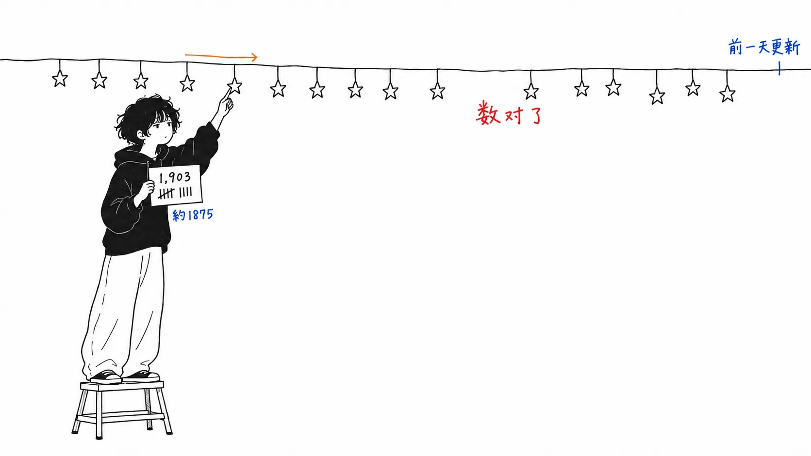

先说结论。

> 能核实的地方**全都对**。GitHub 仓库真实存在，连 star 数都和写作时一致。没试过的东西，文中写明了"没试过"。在这个基础上，文章里还混着**一条无从证伪的做法**。读者看不见这条分界线。**准确性，会转移到不准确的部分上。**

## 关于这篇文章

原文是 [@Pluvio9yte（雪踏乌云）的 X Article](https://x.com/Pluvio9yte/status/2097627175193366621)《万字长文如何百分百榨干ChatGPT Pro，发挥超出1000美金价值》（2026 年 9 月 9 日，中文）。它分五节讲解了 ChatGPT Pro 模型的用法。

有人对我说"帮我解析一下，如果是对的就写成文章"，我才去查了它。结果是**大体正确**。下面是具体的分项，以及唯一让我停下来的一点。

**坦率的声明。** 我没有订阅 ChatGPT Pro，所以没有亲自确认过 Pro 模型的行为。我验证的，只是能从外部确认的事实（仓库是否存在、star 数、更新日期）。Codex 桌面版的 UI，我也没有确认。

## 连 star 数都对得上

原文点名列出了两个开源项目。我都用 GitHub API 确认了。

| 文章的说法 | 实际情况（截至 2026 年 9 月 11 日） |
| --- | --- |
| `miuuyy/codex-chatgpt-web`（把 Pro 作为 MCP 接入 Codex） | **真实存在。6,130★**，MIT，最后更新 2026-09-08 |
| `rebel0789/codexpro`（**约 1875 star**） | **真实存在。1,903★**，MIT，最后更新 2026-08-08 |

`codex-chatgpt-web` 的描述是 "Use ChatGPT Web (including Pro) as a native model in Codex — with context, tools, streaming and images, without using Codex quota."，与文章的说明一致。最后更新是文章发布的**前一天**。这是一个活着的项目。

`codexpro` 的 star 数，文章写的是"约 1875"，现在是 1,903。算下来两天涨了 28，所以写作时应该是准确的。**特意用概数来写也很好**。写法上能让人看出是取了整。

此外，这篇文章里还有两处自我申明。

> 这个项目我并没有试过，不过最近比较火，所以我就列出来了。
>
> 个人观点觉得没有必要，似乎是一个反向生产力，为了用而用了。

写了没试过，**而且还不推荐**。老实写明是因为热门才列出来，又用自己的观点把它否定为"只是为了用而用"。光是有这两行，整篇文章的可信度就上去了。

## 只有一条，无从确认的做法

让我停下来的是这里。

> 4.如果你觉得 Pro 模型回答速度也非常快，质量也很差，不要怀疑，**这是被路由到了降级模型**。比如说，你现在用的 GPT-6，可能会给你路由到 GPT 5.5 Mini。
>
> 5.应对降智的办法也很简单，**使用手机端对话即可**。网页版静待智力恢复。

我分三点来看。

**判断标准没有刻度。** "快"和"质量差"都是主观的。文章自己写了 Pro 的思考时间从几分钟到两小时不等，所以"今天挺快"是常有的事。从哪里开始算降级，没有写出判定的方法。

**这个做法没有机理。** 如果路由发生在服务器一侧，换客户端分配结果应该不会变。如果有说明，比如手机 App 固定用了另一个模型，或者请求了另一个端点，那又另当别论，但文章里没有。只写了"简单"。

**而且，不可能出错。** 这是最大的问题。切换到手机后变好了，就说明这个做法有效。没变好，还有"网页版静待"。等了之后变好了，也算做法成功。**不存在能让人看出这个做法错了的状态。**

顺带一提，标题里的数字在正文里也没有依据。"人们对 ChatGPT Pro 的开发程度不足 10%"，使用率不到 10%。以什么为 100%，哪里都没写。这不影响文章的内容，我觉得属于可以当作标题用的数字放过去的那一类。

## 准确性，会转移到不准确的部分上

我想写的是这里。

能把 star 数用概数写对的人，是有核对习惯的人。能对没试过的东西写上"没试过"的人，是有区分习惯的人。**正因为这两点都做到了，同一篇文章里的"切到手机上就行"，也会被当作同样的质量来读。**

读者这边没有区分的线索。五节全是同一种文风，用同样的列表排着。仓库的 star 数，和降级模型的应对办法，都包含在同一个"在我的经验里"之中。

我不认为这是在责怪作者。在使用中觉得"今天又快又糙"，用手机重新问了一遍结果更好，这样的经历应该是真的。**真实的经历和可以核实的事实，写下来的时候外表是一样的。**

我自己在这个博客上也在做同样的事。数一手资料的那一节，和"我的看法"那一节，在同样的 `##` 下并排着。从读者的角度看，两者的分量应该是一样的。所以我每次都把"坦率的声明"放在开头，先说确认了什么、没确认什么。即便如此，也没法完全分开。

## 我的看法

我觉得这篇文章最有用的部分，其实既不是开源项目，也不是降级的应对办法，而是**第 3 节**。

> 在 Codex 里面，其实也能够进行 ChatGPT 类似于网页端的对话。但与直接在网页端对话不同的是，**Codex 里的对话具有当前项目的上下文**。

在 Codex 里向 Pro 提问，它会**带着那个项目的上下文**来分析。分析完之后，把那份对话记录原样交给 Codex 去执行。作者自己也写了"四个之中我最常用的是第三个"。

这样做的好处在于，它把 Pro 用成的不是"聪明的模型"，而是**"另一个角色的席位"**。把思考的席位和动手的席位分开。我上一篇文章里读到的 Spotify 的 shunt，是把读的工作交给便宜的模型。这个则是反过来，**把思考的工作交给贵的模型**。方向相反，但做的事是一样的，都不再让一个席位包办所有事情。

而且，第 3 节的这个做法里，没有无从确认的部分。UI 有没有，自己看一下就知道；用一用，管不管用也就知道了。**文章最好的部分，同时也是最容易验证的部分。**

## 只带走一件事的话

**请写出一个能让人看出这个做法错了的状态。** 写不出"不管用的话会变成这样"的步骤，谁也判断不了它是否在起作用。自己的笔记、团队的操作手册、博客，都是一样。读了这篇文章，我注意到自己 CLAUDE.md 里写的"遇到麻烦就重建会话"也有同样的问题。

## 出处

- [@Pluvio9yte（雪踏乌云），《万字长文如何百分百榨干ChatGPT Pro，发挥超出1000美金价值》](https://x.com/Pluvio9yte/status/2097627175193366621)，X Article，2026 年 9 月 9 日
- [miuuyy/codex-chatgpt-web](https://github.com/miuuyy/codex-chatgpt-web)：截至 2026 年 9 月 11 日 6,130★，MIT
- [rebel0789/codexpro](https://github.com/rebel0789/codexpro)：同日 1,903★，MIT

star 数和最后更新日期，是 2026 年 9 月 11 日从 GitHub API 获取的。与文章发布（9 月 9 日）之间有差值。

我没有订阅 ChatGPT Pro。关于 Pro 模型的响应速度、思考时间、有没有降级，我一概没有亲自确认。我写"没有说明机理"，**并不是说这样的现象没有发生**，而是说文章没有写出说明。如果路由确实在发生，并且存在随客户端不同而改变分配的机制，那我的指摘就错了。知道的朋友请告诉我。
