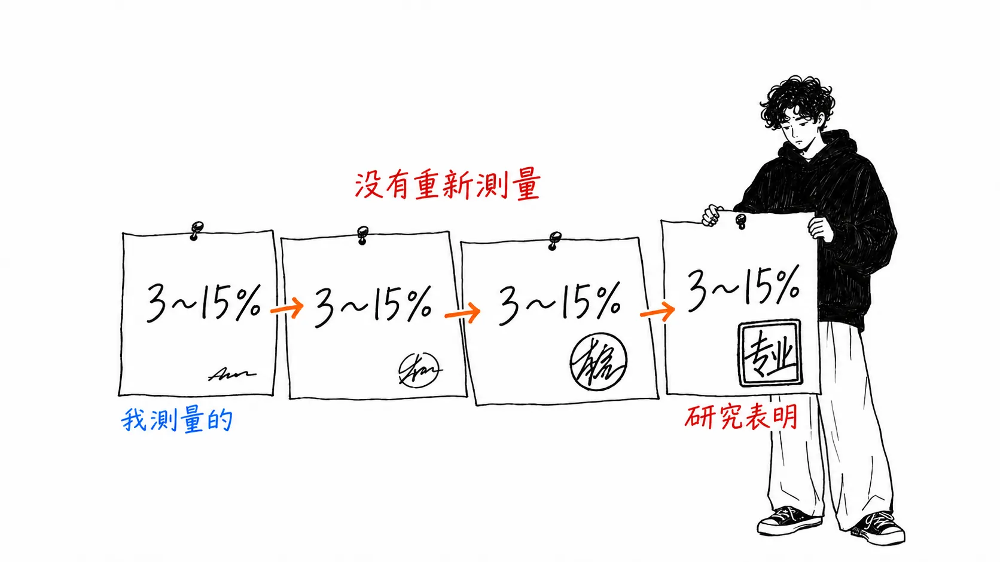
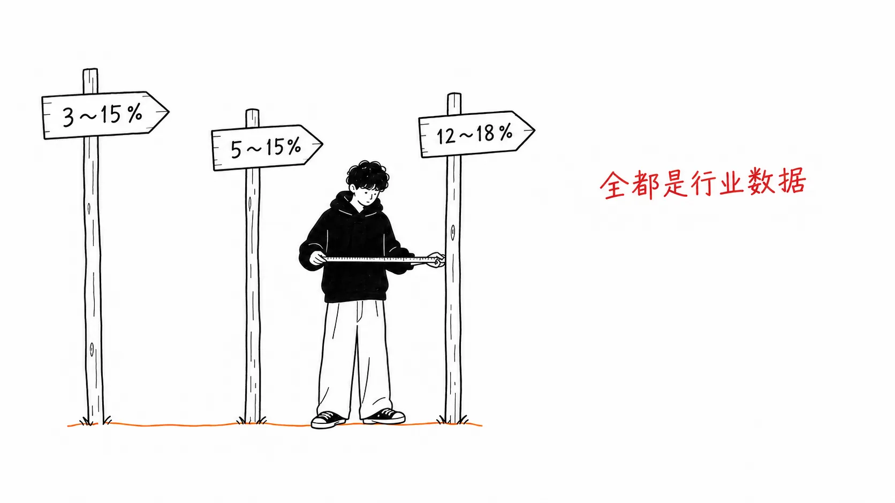
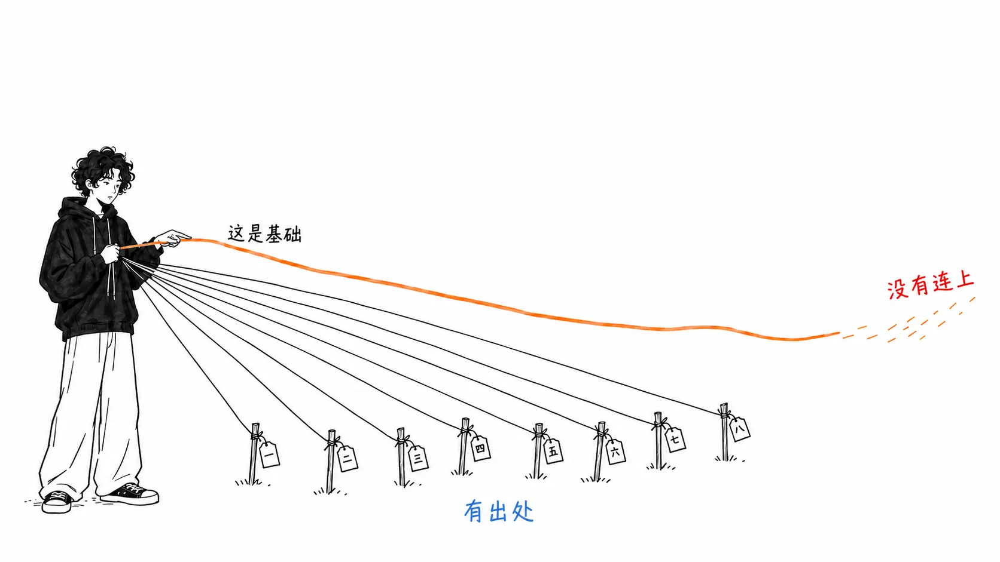
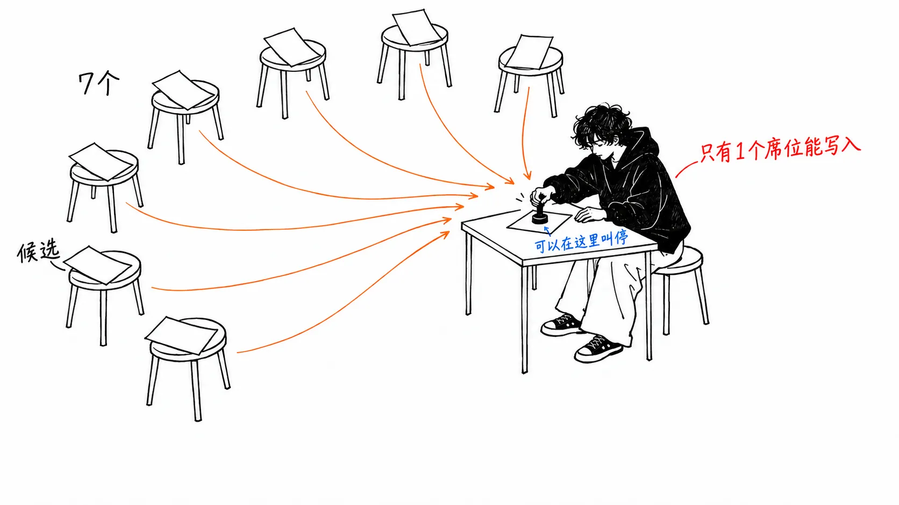

先说结论。

> 把“生产环境中的工具调用有 3-15% 会失败”这个数字追溯到出处，最后落在**一篇个人博客上，作者写的是“我知道，因为我一直在自己追踪”**。里面没写方法，也没写样本量。十个月之后，它变成了“跨生产环境的研究表明”。我不是说这个数字错了。我想说的是：**根本不存在这样的测量。**

## 关于这篇文章

原文是 [@gippp69 的 X Article](https://x.com/gippp69/status/2097696163424014406)《How to Build a Business Back Office That Runs on Agents with GPT-6 Astra (Complete Guide)》（2026 年 9 月 9 日）。

先说在前面，**这是一篇好文章**。它有出处一节，SDK 的规格、价格、Temporal 都标明了来源。倒数第二节（作者自己不会再重做的三件事），是这类指南里很少能读到的水准。

即便如此，文章自己说“这就是整篇文章”的那个数字，出处却是模糊的。这篇是我追溯它的记录。

**坦白说明。** 我没有用 OpenAI Agents SDK 搭过这套架构。下面的内容只依据原文，以及追溯数字出处时的搜索结果。GPT-6 Astra 的价格、上下文长度、基准测试数值，都是原样引用原文的叙述，我没有在 OpenAI 的一手页面上核实过。

## 我追溯了那个被说成“这就是整篇文章”的数字

原文开头是这样写的。

> Tool calling, the mechanism by which every agent in every one of those guides actually touches a real system, **fails between 3% and 15% of the time in production. Not in bad systems. In well engineered ones.**
>
> That is the whole article.

文章的结构也确实如此：八个 agent、八步构建流程、六种悄无声息的失败，最后以“3-15% 不是以后再处理的边界情况，而是设计上的约束”收尾。数字一动，文章的骨架就跟着动。

我追溯了一下。

| 出处 | 日期 | 写法 |
| --- | --- | --- |
| Michael Hannecke（Medium） | 2025-10-29 | 3-15%。**"I know this because I've been tracking it."** |
| Scalekit（博客） | 2026-05-26 | 3-15%。断言式，无出处 |
| Openlayer（博客） | 2026-07-21 | 3-15%。**"Research across production deployments shows"** |
| 原文 | 2026-09-09 | 3-15%。“即使是 well engineered 的系统” |

我找到的最早一篇是 Hannecke 的文章。那是**一位工程师写下“我知道，因为我一直在自己追踪”**。样本量、时间跨度、把什么算作失败，都没有写。我觉得这是诚实的写法。当作个人观察来读，没有任何问题。

经过十个月，它变成了“Research across production deployments shows”。主语从个人变成了研究。这期间并没有任何迹象表明做过新的测量。**同一个数字，每被引用一次，身份就被抬高一级。**

## 同一时期，还有另外三个“行业数字”在流传

如果 3-15% 真是行业共识，就不该出现别的数字。可它们出现了。

| 出处 | 数字 | 框架 |
| --- | --- | --- |
| AgentMarketCap（2026-04-10） | **12-18%**，"The industry has a number for this gap" | 生产环境的 pipeline |
| cheesecat / JK Labs（2026-05-17） | **5-15%** | 作为协议问题 |
| Presenc AI（2026-05-07） | 5 个工具时 85-91%，超过 20 个时 65-78%（即失败 9-35%） | **引用了 BFCL v3** |

三个都自称是“行业数字”。3-15%、5-15%、12-18%。**不可能全都是行业数字。**

有意思的是 Presenc AI，只有它的框架不同。它没有给出一个单一区间，而是把数字表示成**工具数量的函数**：5 个时 85-91%，超过 20 个时 65-78%。而且它引用了一项有名有姓的测量，也就是 UC Berkeley 的 BFCL v3 排行榜。它甚至给出了失败的构成：参数不匹配约 38%，类型转换错误约 24%，选错工具约 18%。

把数字取整成一个，就是“3-15%”；不取整，就成了“取决于你有多少个工具”。**后者，对做设计的人才有用。**

## 一篇有出处一节的文章，偏偏只在一个地方含糊了

原文有出处一节，这一点值得称赞。

- SDK 的 primitive、sandbox 的 permissions、sessions、与 Responses API 的取舍 → OpenAI 官方文档和 `openai/openai-agents-python`
- Astra 的价格、272K 的阈值、上下文长度、首次成功率 → OpenAI 的模型文档和 OpenRouter
- Agent Builder 与 Evals 的终止日期 → OpenAI 的 AgentKit 页面
- 持久化执行 → temporal.io

很具体。而出问题的那一行是这样的。

> The 3-15% tool call failure figure and the ChatDev correctness number come from **published production write-ups**.

没有链接。“published production write-ups”到底是谁的、是什么，没有写。**一篇把十处出处都交代清楚的文章，偏偏只有作为全文根基的那一个，没留下名字。**

我不认为这是故意的。作者大概也觉得这是“大家都知道的数字”。我自己在读这篇文章之前，也是这么想的。

## 一个数字都没出现的那一节，最好

文章第 10 节“What I would cut if I started this over”里，几乎没有数字。这一节最好。

**第一，把分类器做成了独立的 agent。** 它只是读一张工单，返回一个类别。那不是一个席位，而是一次函数调用。借用作者的说法，

> If a seat has no tools and no branch, it is **a function call wearing a costume**.

**第二，把重试当成了万能药。** 失败的工具调用最多重试三次。纸面上，5% 变成了 0.0125%。而在写入路径上，**一张重复的发票会变成三张。** “先要有幂等键，才轮得到谈重试次数”这个顺序，只有真正实现过的人才写得出来。

**第三，没有校准过的置信度。** 抽取器返回 0 到 1，低于 0.7 的就丢弃。拿 100 条和原件逐一核对之后发现，**0.65 和 0.9 的准确率几乎一样**。也就是说，这个阈值只是在随机地丢弃工作。

> A number you have not measured against reality is a decoration that looks like a control.

没有拿现实去衡量过的数字，是看起来像控制手段的装饰品。

这句话，原封不动地适用于文章开头的那个 3-15%。

## 我的看法

我并不想抨击这篇文章。**我想谈的是结构。**

三条悔意，形状都是“自己做了、自己测了、结果错了”。里面有一行写着“核对了 100 条”。而开头的 3-15%，却没有测量它的人。**在同一篇文章里，验证的密度在两端截然相反。**

这不是作者偷懒，大概是文章写法上的问题。开头需要一个“读者不知道的震撼数字”。自己的实测很朴素，凑不成一个区间。于是借来的数字被放到前面，自己的测量被放到后面。**越是借来的，越被放在前面；越是自己做的，越被放在后面。**

我自己的文章里也这么干过。前两篇里，我没能读懂 Anthropic 的那张图，就靠两端两个点定下了曲线的形状，结果错了。那也是出于“想用手头的数字尽快下结论”。

还有一点。**即使 3-15% 是对的，也没法用在设计上。** 3% 和 15% 相差五倍。相差五倍的数字，会改变重试策略、人工 review 放在哪里、席位怎么划分。如果像 Presenc AI 那样说“5 个工具时 85-91%”，就能决定该配多少个工具。**区间很宽的数字，宽本身就是“没有测量过”的证据。**

而原文的设计本身，也就是**“七个席位生成候选，只有一个席位提交”**，没有数字也是对的。把无法撤销的操作集中在一处，审计、限流、停止都在那里做。这是一个在 3%、15%、41% 时都成立的设计。**文章的主张，并不依赖于它自称为根基的那个数字。**

## 只带走一件事的话

**看到以区间形式写出的“行业数字”，请用上限除以下限。** 3-15% 是五倍，12-18% 是 1.5 倍。前者是印象而不是测量，后者还保持着测量的样子。把一个五倍的区间放在设计的前提里，造出什么都会是“在预料之中”。

## 出处

- [@gippp69, "How to Build a Business Back Office That Runs on Agents with GPT-6 Astra (Complete Guide)"](https://x.com/gippp69/status/2097696163424014406)，X Article，2026 年 9 月 9 日
- Michael Hannecke，["Why AI Agents Fail in Production: What I've Learned the Hard Way"](https://medium.com/@michael.hannecke/why-ai-agents-fail-in-production-what-ive-learned-the-hard-way-05f5df98cbe5)，Medium，2025 年 10 月 29 日。我找到的最早的“3-15%”
- [Scalekit, "Tool Call Failures in Production"](https://www.scalekit.com/blog/tool-call-failures-production)（2026 年 5 月 26 日）
- [Openlayer, "AI Agent Failure Modes"](https://www.openlayer.com/blog/ai-agent-failure-modes-tool-calling-loops-propagation)（2026 年 7 月 21 日）
- [AgentMarketCap（2026 年 4 月 10 日）](https://agentmarketcap.ai/blog/2026/04/10/agent-tool-call-retry-failure-mode-handling-production-2026)：12-18%
- [Presenc AI, "AI Agent Tool-Calling Accuracy Benchmarks 2026"](https://presenc.ai/research/ai-agent-tool-calling-accuracy-benchmarks-2026)（2026 年 5 月 7 日）：引用了 BFCL v3
- [JK Labs（2026 年 5 月 17 日）](https://cheesecat.net/blog/ai-agent-tool-calling-reliability-production-checklist-2026/)：5-15%

我写“我找到的最早的”，并不是说在 Hannecke 之前没有任何文章给出过同样的数字。意思是**在我的搜索所能追溯到的范围内，那是最早的**。如果有人知道更早的出处，请告诉我。那会推翻这篇文章的主张，而那样反而更好。

GPT-6 Astra 的数值（1,050,000 token；超过 272,000 后输入和缓存翻倍、输出为 1.5 倍，并适用于整个请求；首次成功率 88.0% 对 55.9%；4 次以内 99.2% 对 68.7%；提示词注入成功率 11.2%），全部是原文的叙述。我没有在 OpenAI 的一手页面上核实过。
