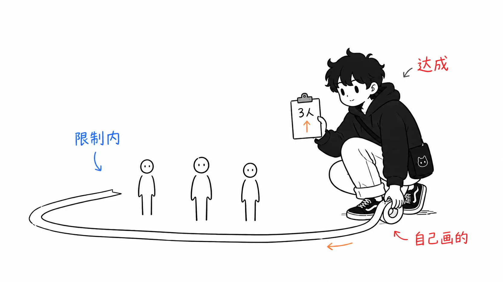
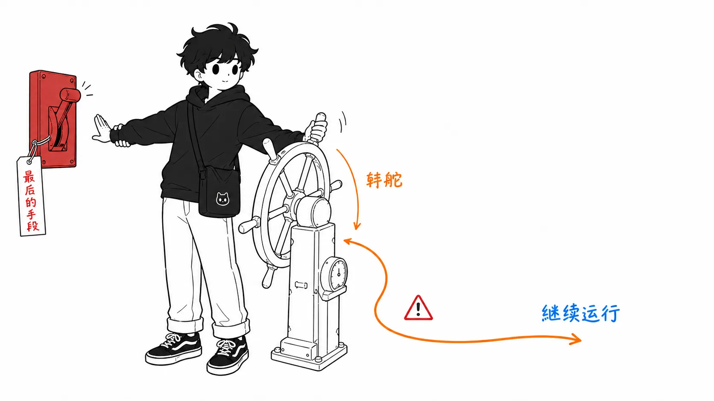

先说结论。

> 读一下那个以“token 花费砍掉 78%，完成率还从 67% 升到 96%”的形式流传的故事的一手资料就会发现，**对照组不是“硬性限制（节流）”，而是“没有治理”**，指标也不是“任务完成率”，而是**“在预算上限内跑完的 run 所占的比例”**（within-cap success）。N=27，每个 run 从 $0.068 降到 $0.014。他们做出来的系统很有意思，数字也是实测的，但被引用得最多的那句话，大概说的是一个没人做过的实验。

## 关于这篇文章

这篇讲的是 Microsoft 的 Tisha Chawla 和 Susheem Koul 做的 **TokenOps**，一个以智能体的 run 为单位、在运行时控制 token 支出的系统。

- 一手资料：[Who spent all the tokens? Real-time, run-scoped cost control for AI agents](https://commandline.microsoft.com/tokenops-real-time-run-scoped-cost-control-ai-agents/) — Tisha Chawla, Susheem Koul（Microsoft Command Line，2026 年 8 月 13 日）
- 演讲：[Who Spent All the Tokens? — Tisha Chawla & Susheem Koul, Microsoft](https://www.youtube.com/watch?v=GJX19pNhmSw)（AI Engineer）
- 代码：[github.com/theagentplane/tokenops](https://github.com/theagentplane/tokenops)

我是通过一篇中文圈的摘要知道这件事的，那里是这样介绍的：“token 花费砍了 78%，任务完成率却从 67% 飙升到 96%。常识上，省 token 最快的办法是硬性限制、直接掐断，但那样钱是省了，任务也死了。而 Microsoft 却……”

我觉得这个叙事框架很有意思，就去读了一手资料。读完发现，对照组不一样。

先坦白：我没有跑过基准测试，也没有读过仓库里的代码。演讲视频也没有完整看完（只读了一部分文字稿）。以下说的，都限于我读过的 Command Line 文章正文这个范围。

## 原文的数字是这样写的

引用相关段落。粗体是我加的。

> - Cost: mean cost per completed run. 78.9% lower than no governance: $0.068 → $0.014 average spend per run (weighted total $1.839 → $0.388, N=27 scored trials across browser-use and MetaGPT scenarios).
> - Completion: share of runs that **finish under the cap**, **vs. no governance**. +29pp: 67% → 96% **within-cap success** (18/27 → 26/27), N=27.

摘要里漏掉了三点。

**1. 对照组是“没有治理”。** 不是节流。原文在这一段之前，特意声明了比较的基准：“the baseline that governs the demand for this post: no governance at all”。也就是说，这是“什么都不做 vs TokenOps”的比较，而“硬性掐断 vs 聪明地调整方向”这种对比实验，在这篇文章里根本不存在。

**2. 指标是 within-cap success。** 即“在预算上限之内跑完的 run 所占的比例”。不是任务有没有成功。没有治理时的那 33%（27 次中的 9 次），**不是任务死了，而是超了预算**。原文的措辞处处精确，换了两种说法：“finish under the cap”和“within-cap success”。翻译时如果写成“完成率”，意思就变了。

**3. N=27。** browser-use 和 MetaGPT 两个仓库的场景加在一起，共 27 次试验。每个 run 的平均值是 $0.068 → $0.014。说的是 7 美分变成 1.4 美分的事。

## “控制在预算内的比例提高了”，这到底算多大的主张

这是我卡住的地方。

引入预算上限，再装一套中途调整方向、避免超出上限的系统。结果“在上限内跑完的 run 的比例”提高了。……这在相当大程度上是从设计的定义里直接出来的。为了守住上限而造的机制，提高了守住上限的比例。如果没提高，那才是新闻。

当然，这也不是完全的同义反复。**靠 HALT（掐断）来守住上限，并不会提高 within-cap success。** 因为撞上上限被杀掉的 run，不算“在上限内跑完”。所以 26/27 这个数字，意味着“调整了方向、控制在上限内、而且还跑完了”这件事发生了 26 次，这里面是有实质的。把它读成原文的 STEER 设计（把模型降到便宜的那个、压缩提示词、修复坏掉的循环）起了作用，是说得通的。

但从这里到不了“任务完成率提高了”。到不了的理由，原文自己写了。这是整篇文章里最诚实的一节。

> To be clear about the boundary: everything above governs cost. (...) It does not decide whether the spend was worth it. A cost cap halts on dollars; it cannot see whether the dollars bought a correct answer.

接着它引用了 MAST（Berkeley 关于多智能体失败的研究），说多智能体失败有一半以上是规格和验证的问题，成本上限分不出正确答案和错误答案。**作者自己明说“没有衡量质量”的文章，其中的数字却被当作“质量提高了”的证据在流传。** 这是这次我觉得最有意思的地方。

在我看来，失真发生在一个步骤里：原文的小标题词 “Completion”。内容是 within-cap success，但只把标题抽出来，就像是 completion rate。到了做成表格的阶段，列名变成了“完成率”，对照组从 “no governance” 被换成了“节流”，还添上了一句原文里没有的“掐断的话有 33% 会死”。一次摘要，就造出了一个没人测过的实验。



## 即便如此仍值得一读的三个部分

我对数字的解读挑了毛病，但文章本身相当不错。我带走的不是指标的话题，而是这几点。

### 1. 把 $2 的上限变成实际 $4 的 bug

这是最实用的一个。测试台让两个智能体在不同进程里运行。一个在搜索工具上循环的 research agent，通过 HTTP 把 findings 交给 summarizer agent。两者共用同一个 run id，run 带有预算。测试全部通过了，却有 bug。

> 每个进程把支出计数器放在自己的内存里。两边都从零开始，都看到 run 预算的全额，所以 $2 的 run 上限实际上成了“research agent 有 $2，summarizer 再有 $2”。加起来能花掉上限的两倍，而本地的检查全都通过。

修复方法是把计数器挪到进程之外的共享 ledger 里。原文的一般化是这样：**在多智能体的 run 里，各个智能体自己数的预算，不是 run 的预算。**

这不是 LLM 的话题，而是分布式系统的话题。所以反过来说，就算 LLM 的情况变了，它也不会过时。读到这里，我意识到自己所谓的“预算”是否真的有唯一可信的数据源，我一次也没确认过。


### 2. 策略清单是从成本公式推导出来的

原文不是先把策略一条条摆出来。它先写 run 的成本是由什么构成的。

```
cost of a run = Σ over calls ( input tokens × input price + output tokens × output price )

calls per run = loop depth × fan-out breadth
                (逐次ステップ)   (並列サブエージェント)
```

决定账单的只有两样：“单次调用的 token 数”和“调用次数”。调用次数的来源也只有两个（循环的深度，以及子智能体的扩散宽度）。所以要守护的对象是一份封闭的清单：单次 token 数、循环深度、fan-out，以及总额的天花板。原文的策略有 10 条，`cost_budget` 是天花板，其余 9 条各自守住一个点。

我觉得论证得好的是下面这句。

> 这份清单是从成本推导出来的，但也与失败研究的结果一致。OWASP 的 Unbounded Consumption、Microsoft 的 agentic failure taxonomy (v2.0)、Berkeley 的 MAST 列出了同样的模式：循环、没有进展的重复、退化的输出、过大的上下文和负载、不合法的工具调用、无限制的 fan-out。从两个方向走到同一份清单，是没有漏掉明显模式的有力证据。

从成本优化角度枚举出的清单，和从安全／故障分析角度枚举出的清单一致。这种确认方式，也可以用在自己的设计检查清单上。

### 3. STEER 在先，HALT 在最后

这是设计顺序的事，一句话就能说完。

> Steering runs first. A halt is the last resort because halting a legitimate run causes the outage you were trying to avoid.

掐断，会亲手造成自己本想避免的故障。所以放在最后。而且，执行（enforcement）路径上完全不放模型，这个决定也很明确。因为“不想让被治理的对象自己决定要不要停下自己”。这里他们引用了 CaMeL（作为提示词注入的对策，在模型外部放置一个确定性控制层的方法），说威胁不同，但设计是一样的。我觉得这个对应做得很漂亮。



## 虽然琐碎但要写下的两点

**仓库不在 Microsoft 组织之下。** 它是 [github.com/theagentplane/tokenops](https://github.com/theagentplane/tokenops)。“Microsoft 工程师做的开源”和“Microsoft 的开源”是两回事，前者才对。顺带一提，Microsoft 组织下另有一个叫 [agent-governance-toolkit](https://github.com/microsoft/agent-governance-toolkit) 的项目，那是安全侧的治理，不是成本。容易混淆。

**这篇文章不是产品宣传，而是对分层的主张。** 原文后半部分有一张“哪些层已经存在、哪里是空白”的表，依次填入：accounting 是 FOCUS，observability 是 OpenTelemetry GenAI conventions，按请求的 enforcement 是 LiteLLM / Portkey / Cloudflare，步数上限是 LangGraph 的 `recursion_limit` 和 CrewAI 的 `max_iter`，而按 run 的 enforcement 是唯一空着的。我觉得这个梳理，比 78% 的寿命更长。

## 如果只带走一件事

不是数字的事。

**读指标的定义，而不是名字。** 这次的偏差，出在“Completion”这个标题和 “share of runs that finish under the cap” 这个定义之间。标题能熬过摘要，定义却会掉。只有掉掉的那一边，才写着这个数字究竟是什么的证据。

还有，当你自己引用这类基准测试时，要把 N 一起写上。N=27 是“方向上的提示”，不是“可以期待削减 78%”。原文好好地写了 N。把它丢掉的是做摘要的一方（我也差点丢掉）。

## 出处

- Tisha Chawla, Susheem Koul, [Who spent all the tokens? Real-time, run-scoped cost control for AI agents](https://commandline.microsoft.com/tokenops-real-time-run-scoped-cost-control-ai-agents/), Microsoft Command Line，2026 年 8 月 13 日
- 演讲：[Who Spent All the Tokens? — Tisha Chawla & Susheem Koul, Microsoft](https://www.youtube.com/watch?v=GJX19pNhmSw), AI Engineer
- 代码：[github.com/theagentplane/tokenops](https://github.com/theagentplane/tokenops)

文中的数值和引用，全部来自上面的 Command Line 文章。我没有复现基准测试，也没有读仓库里的代码。演讲没有完整看完。“‘控制在预算内的比例提高了’，这到底算多大的主张”一节的后半部分，是我对指标解读的论述，不是原文的主张。
