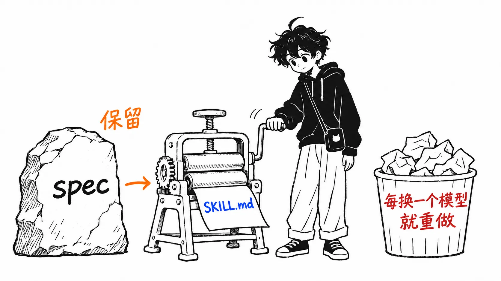
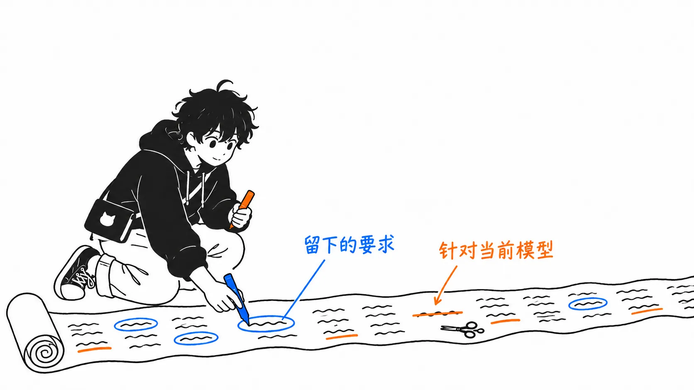

2026 年 11 月 23 日（UTC），Uber Engineering 在 X 上发布了一篇文章，标题是"How Uber Evals 1 Million Agent Skill Invocations a Month"。相同的内容也登载在 Uber 的博客上。开头的数字是这样的。

> Uber's shared skills marketplace grew from 1 skill in October 2025 to more than 5,000 in just one year. Thousands of people have written a skill, and agents invoked skills more than 1 million times in just one month.
>
> （Uber 的共享技能市场，从 2025 年 10 月的 1 个技能，一年内增长到 5,000 多个。数千人写过技能，智能体调用技能的次数，一个月内超过 100 万次。）

文章涉及的内容很广：分发用的 CLI、三层的层级结构、使用情况的计量、linter、eval、成本削减，以及智能体自己报告缺陷的机制。

先说结论。

> Uber 有一套机制：从 spec 生成 SKILL.md，模型一变就重新生成。我把这理解为：Uber 把模型换了也要保留的文字（spec）和为当前模型重新生成的文字（SKILL.md）分到了不同的文件里。我手头的技能里，这两种文字混在同一个 SKILL.md 里。模型变了的时候，我不知道哪些可以删，所以决定把它们分开。

---

## 用大白话说

让 AI 干活时，要给它一份"这件事这样做"的操作手册，这就叫"技能"。在 Uber，员工写了 5,000 多份这样的手册，AI 一个月里用了 100 多万次。

手册里混着两种句子。一种是"做到什么算合格"，换了新的 AI 也不会变的约定；另一种是"对现在的 AI 这么说它才懂"，迁就当前 AI 脾气的措辞。后一种在 AI 换代后就不合适了。

Uber 把前一种写在另一张纸上，叫"设计书（spec）"，后一种则由这份设计书重新生成。我的手册把两种混在一张纸上，AI 一换就不知道哪些可以删，所以我决定把它们分开。这篇讲的就是这个。

## 关于这篇文章

我读的是 X 文章正文的文本。正文中嵌入的图片（图表和截图）我没有看。文章所引用的 Cloudflare 的 Code Mode 文章、Uber 的另一篇文章（efficient software factory）、Agent Skills 的规范，我也都没有读。

我的立场也写在这里。这个博客的文章是用 Claude Code 的技能写的。Uber 的内部工具 aifx 和 Skill Workshop 我没有用过。

## SKILL.md 是由 spec 生成的

文章一开始把技能定义为"Markdown 文件"。但读到质量那一节就会发现，有一条从 spec 生成这份 Markdown 的路径。TL;DR 的条目之一也是"Write the spec first"（先写 spec）。

> The spec keeps the intent of the skill: its goal, its outputs, the tool actions that are required or forbidden, and the agents and models it targets.
>
> （spec 保存技能的意图：目标、输出、必须或禁止的工具操作，以及面向的智能体和模型。）

一个叫 Skill Workshop 的内部工具，会根据这份 spec 生成 SKILL.md 和测试用的提示词，模型或智能体变了就重新生成。今后的计划里还提到，要按模型系列分别写 SKILL.md。理由是措辞和长度的最佳形式因模型而异。

文章没有写 5,000 个技能是否全部通过这条路径生成。文中说，SKILL.md 现在仍然由作者根据实际运行情况修改，在 Core 层级则由团队维护并审查变更。在此之上，他们还做删减文字的试验。

> As models get better, more words can reduce performance, so we also test removing words from skills.
>
> （模型越好，文字多了反而可能拉低性能。所以我们也做从技能中删减文字的试验。）

这项试验的结果，文章里没有写。不过方针很明确。文章还写到，技能有寿命，如果更好的模型让它变得不再需要，就会被废止。

从这里开始是我自己的整理。目标、输出、必须遵守的操作这类即使模型变了也不容易变的东西，放在 spec 里；面向当前模型的措辞，放在 SKILL.md 里。后者可以重新生成，也可以删掉（不过 spec 里也写了目标模型，所以一旦更换目标，spec 也会变）。在我看来，Uber 放在保留一侧的，是 spec、eval，以及全公司的技能按名字引用的 Code Mode 脚本包。linter 的规则（给步骤编号、一个步骤一个目的、放一张错误恢复表、不承认"Try again"算恢复措施）是用机器来检查 SKILL.md 的形式。

eval 的设计文章里也写了。拥有固定输入和期望输出的 golden 用例约占 5%，用轨迹（是否按正确的顺序使用了正确的技能和工具）给真实提示词打分的约占 80%，由作者判定的约占 15%。文章还写到，通过率 70% 到 90% 的 eval，有时比全部通过的 eval 更有用。因为如果全部通过，可能是漏掉了答案中有意义的变化。即便如此，文章的结尾还是承认，对那些很少运行、很重要、又难以判定的工作流的评估，仍然没有解决。

## 起效的数字，是对技能整体有无的比较

文章里最引人注目的数字，是 ablation（去掉技能再做比较的试验）的结果。

> In our ablation test of a skill that runs warehouse queries, sessions without the skill made 13% more tool calls, had six times as many tool errors, and took 31% longer, and the answer with the skill won 87% of the comparisons.
>
> （在对一个执行数据仓库查询的技能做的 ablation 试验中，没有该技能的会话，工具调用多了 13%，工具错误是 6 倍，耗时长了 31%。有该技能的答案，在 87% 的比较中获胜。）

这是针对一个技能、比较有无该技能的数字。技能的哪个部分起了作用，并没有拆开。比较的数量也没有写。至于什么样的技能起了效果，文章是这样写的。

> The biggest wins came from skills that give the agent something it couldn't easily find or understand, such as access to internal documents or a way to run warehouse queries.
>
> （最大的收获来自这样的技能：它们给智能体提供自己很难找到或很难理解的东西，比如访问内部文档，或者执行数据仓库查询的手段。）

对于技能整体，只写了"In a majority of the cases"（在大半情况下）有所改善，没有给出比例。

成本削减的措施列了 4 项，其中有削减率数字的是 2 项。一项是把沉重的工具结果交给更便宜的模型的 worker 处理，追踪技能每次调用的成本下降了 46%（同一措施下，部署技能在第一周没有下降）。另一项是在加载时执行脚本，把结果放进提示词，搜索技能的平均成本下降了 32%。剩下的 2 项，Code Mode 和轮询的拆分，没有写削减率。

读这些数字时也需要留意。技能每次调用的成本，是从定期报告的累计成本中，取调用前的最后一个值和调用后的第一个值之差，所以也包含这期间的其他工具调用。46% 和 32% 是变更前后的比较，有没有对照组，文章没有写。

## 发现缺陷的是智能体

通过智能体自己报告缺陷的"papercut"机制，3 个月里报告了数千件，修复了数百件。文中列了 4 个例子。

> A deployment skill told the agent to pass epoch seconds where the API expects milliseconds.
>
> （某个部署技能，在 API 要求毫秒的地方，指示智能体传入纪元秒。）

另外 3 个是：pull request 技能把提交信息写进共享的临时文件，导致同时运行的两个会话互相改写了对方的 pull request；在没有 CI 的仓库里一直等待 CI，重复着同一个 404；查询设置的技能在键不存在时不报错，而是返回了另一个属性。

错误是出在技能的步骤文字里，还是出在附带的脚本里，原文没有写。在我看来，其中 3 个是步骤指示了什么的问题，1 个是返回值的问题。没有一个属于措辞难懂这一类问题。而且 4 个都是通过智能体的报告发现的。

## 我的见解

让我在意的，不是文章说"要减少文字"，而是它在决定"留下哪些文字"。

spec 也是文字：写着目标、输出、禁止的操作。区别在于，其中有很多部分即使模型变了也不需要改写。而 SKILL.md 的措辞，是针对当前模型的调整，模型变了就要重新生成。Uber 把这两种文字分到了不同的文件里。

我手头的技能里，这两种文字混在同一个 SKILL.md 里。写文章的技能里，像"插图和三种语言没齐就不能说完成"这种不随模型改变的要求，和像"避免这种措辞"这种针对当前模型习惯的调整，以同样的语气并排放着。两者都是我手工打磨出来的。

混在一起会有什么麻烦？模型变了的时候，我不知道哪些可以删。就算想像 Uber 那样做删减文字的试验，也会变成连不能删的要求一起删掉的试验。

不过，这并不是说文字不好。拦住我文章中错误的，是逐字核对引用是否在原文中出现的脚本，以及在另一个上下文中读文章的审阅者。在我刚刚发布的[文章](https://meikocho1.github.io/blog/efs-zero-data-retention-two-copies/)里，审阅者指出了 6 处事实错误，我全部改正了（这只是一个例子）。驱动这个审阅者的，是我写的委托文，也就是一段文字。委托文的内容，大部分是"把事实与原文核对""指出没有依据的亲身经历"这类不随模型改变的要求。它接近 spec，所以我预想即使换模型也能用得更久（我没有比较过换模型前后审阅者的表现，所以并没有确认过）。

还有一点。"插图和三种语言是必须的"是应该放进 spec 的要求，而且可以用机器来检查。现在它只是用文字加在 SKILL.md 里，还没有检查的脚本。读了 Uber 的文章，我决定写这个检查（还没有写）。

## 只带走一件事的话

把自己技能里的句子逐句过一遍，标出"模型变了也会留下的要求"和"面向当前模型的措辞"。前者作为 spec 另外放置，能做成检查的就做成检查。后者，是可以拿去做删减试验的部分。

出处：Uber Engineering《[How Uber Evals 1 Million Agent Skill Invocations a Month](https://x.com/i/article/2120222611070500864)》以及介绍它的[帖子](https://x.com/ubereng/status/2125008806249930999)（X，2026 年 11 月 23 日 UTC）。相同内容的 Uber 博客文章是《[optimizing-ubers-agent-skills](https://www.uber.com/us/en/blog/optimizing-ubers-agent-skills/)》。正文中的图片、所引用的 Cloudflare 的文章、Uber 的另一篇文章、Agent Skills 的规范，我都没有读。
