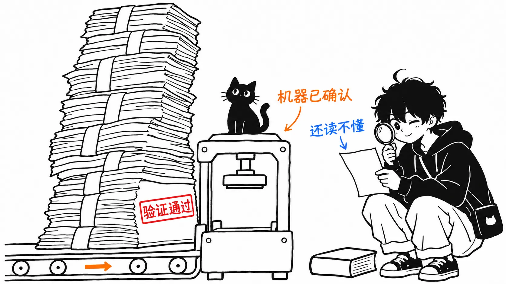
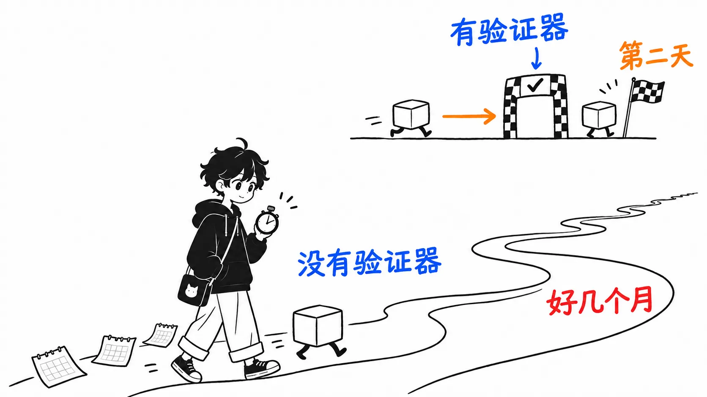

2026 年 11 月 20 日，在 Anthropic 工作的数学家 Levent Alpöge 宣布，他与 Claude 一起证明了黎曼猜想。证明没有以普通论文的形式发表，而是作为定理证明辅助系统 Lean 的约 1,700 万行代码公开，第二天 21 日，Lean 和 Mathlib 社区发表联合声明，确认代码通过了验证，并且与原命题一致。

11 月 22 日（UTC），Meta 的 Chief AI Officer Alexandr Wang 在 X 上发表了题为"Superintelligence is Arriving"的文章。开头是这样的。

> Superintelligence is arriving. How humanity acts over the next year will have great consequence on what future world we live in.
>
> （超级智能正在到来。未来这一年人类怎么行动，将极大地影响我们最终生活在什么样的未来世界。）

先说结论。

> Wang 把黎曼猜想的证明解读为智能已经足够的证据。我的解读是，这个证明在发表的第二天就通过了验证，是因为尽管人还没有理解其中的内容，却有 Lean 这个机器验证器。Wang 作为剩余课题放进括号里的“实验、数据、反馈的回路”，正对应着其他领域的 Lean，我认为在没有它的领域，是跑不出同样的速度的。

---

## 关于这篇文章

我读的是 Wang 在 X 上那篇文章的正文。证明的经过，我通过 Al Jazeera 和 techno-science.net 的文章做了确认。Alpöge 本人发在网站上的 4 页说明，以及 Lean 和 Mathlib 的联合声明本身，我没有读。证明的 Lean 代码我也没有看过。

我的立场也写一下。我不是数学家，没有能力评价黎曼猜想证明的内容。这篇文章谈的，是 Wang 的论证是怎么搭起来的，以及证明通过验证的路径。

## Wang 的论证

论证的结构，是对智力难度的排序。

首先，他写道，2024 年 12 月 o3 在数学竞赛 AIME 上取得高分时，对有竞赛数学经验的人来说，出现了一个“一切都变了”的瞬间。AIME 的难题比工程师和商务人士每天解决的问题难得多。要把模型推广到其他领域，需要各领域的知识和语境，但缺的并不是原始的智能。他说，这两年里，编程已经基本被解决，强大的网络安全能力和 agent 能力也出现了。

接着，他继续写道，AIME 是十几岁孩子的课外活动，而黎曼猜想可能是人类思考过的问题中智力上最严苛的一个。

> The remaining gaps for models to greatly surpass humanity in every field are no longer intelligence; they are domain-specific know-how, plumbing, and experimentation.
>
> （要让模型在所有领域大幅超越人类，剩下的差距已经不再是智能；而是各领域的专有技能、管道，以及实验。）

AI 研究也比黎曼猜想容易得多，所以模型会通过自动化 AI 研究、改进自己，明显超越人类。生物学、武器、经济学的研究也会大大加速。而且，正如数学界还没有完全消化黎曼猜想的证明一样，他写道，大多数领域都可能以人类既无法理解也无法监督的速度加速。

后半部分是警告。很难想象人类能继续控制完全不受约束的递归式自我改进。业界有一种懒惰的想法，认为“ASI 不可避免，问题只在于如何安全地造出来”。不能认可把社会“交给”AI。

## 证明在被理解之前就通过了验证

这里来看证明通过验证的路径。

Alpöge 没有发表普通论文，而是在网站上放了 4 页的说明，证明本身则作为 Lean 代码公开。约 1,700 万行，175,187 个文件。据 Al Jazeera 报道，Alpöge 写道"Claude far outpaced me near the finish line"（临近终点时，Claude 远远超过了我）。第二天，Lean 和 Mathlib 社区确认了所有文件都能编译，被证明的命题与原来的猜想一致，证明没有依赖额外的未经证明的假设。

另一方面，内容还没有被理解。伦敦帝国学院的 Kevin Buzzard 对 Al Jazeera 这样说。

> At the minute, we don't even know why the theorem is true
>
> （目前，我们甚至不知道这个定理为什么是对的。）

Buzzard 接着说，1,700 万行换算成数学文字，可能有几万页，哪里是新的想法、哪里只是机器填上的固定套路，也还不清楚。世界各地正在进行把 Lean 代码翻译回英文的工作。不过 Buzzard 也说，只要把 Lean 代码交给人，一两周内理解就会大大推进。理解预计会跟上来。

即便如此，到 11 月 21 日为止，支撑这个证明正确的，不是人的理解，而是 Lean 的验证。Wang 文章里的"the math community has not fully digested the proof"（数学界还没有完全消化这个证明），说的就是这种状态。

## 我的见解

Wang 把这件事用作智能已经足够的证据。我认为，同一件事显示的是另一个条件。在结果可以由机器验证的领域，人在理解之前，就可以信任 AI 的结果。

数学有 Lean。1,700 万行没有人能手工核对，但 Lean 可以。所以在发表的第二天，至少“它是否证明了这个命题”有了答案。Wang 接下来举的那些领域呢？生物学的假说，用实验来确认，长的话要几个月。经济学的政策，有没有效果，有时几年都不知道。Wang 自己写道，MIT 的老师们会说许多领域的最难问题比黎曼猜想“更容易”，然后加了这样一个括号。

> albeit with other challenges such as experimentation, data, and feedback loops.
>
> （只不过还有实验、数据、反馈回路等其他挑战。）

Wang 也把这个列为课题，所以我和他的差别在于权重。我认为括号里面的，比括号外面的更重。实验和反馈回路，就是那个领域的验证器。在没有它们的领域，AI 不管给出多聪明的答案，到确认它正确为止的时间都不会缩短。

仅凭智能解释不了的事，Al Jazeera 的文章里也有。Buzzard 说，应该先评价 Alpöge 本人，同样能用上最前沿模型和算力的其他人，并没有走到这个证明。有一个人决定了往哪个方向去找。

Wang 担心的是，大多数领域可能以“人类既无法理解也无法监督”的速度加速。Wang 说的“监督”，是控制 AI 自我改进的事，和 Lean 的验证是两回事。不过，黎曼猜想的证明表明，即使理解还没有跟上，有了验证器，至少“是否正确”这一点是可以守住的。反过来，如果在没有验证器的领域想跑出同样的速度，结果就会在既无理解也无验证的情况下堆积起来。我害怕的是这一边。

最后，文章里的许多比较是 Wang 的判断。“许多物理学家会同意，与黎曼猜想相比，原子弹的发现只是作业级别”这句话，依据是他本人在洛斯阿拉莫斯长大的见闻。AI 研究比黎曼猜想容易得多、编程基本被解决，这两点也没有给出出处。

## 如果只带走一件事

听到“AI 会加速这个领域”，就去找那个领域的 Lean。也就是在人理解之前，用机器确认结果是否正确的机制。我认为，是从有这种机制的领域开始，依次真正变快。

出处：Alexandr Wang"[Superintelligence is Arriving](https://x.com/i/article/2124634870681063424)"及介绍的[帖子](https://x.com/alexandr_wang/status/2124636606959345776)（X，2026 年 11 月 22 日 UTC）。证明的经过和 Buzzard 的发言来自 Al Jazeera"[Riemann hypothesis: Has the world's most famous maths problem been cracked?](https://www.aljazeera.com/news/2026/11/21/riemann-hypothesis-has-the-worlds-most-famous-maths-problem-been-cracked)"（2026 年 11 月 21 日）。行数、文件数和联合声明的内容来自 techno-science.net"[An AI solves the Riemann hypothesis: 17 million lines for a historic proof](https://www.techno-science.net/en/news/ai-riemann-hypothesis-lean-proof-29823)"。Alpöge 的说明、Lean 和 Mathlib 的联合声明、Lean 代码本身，我都没有读。
